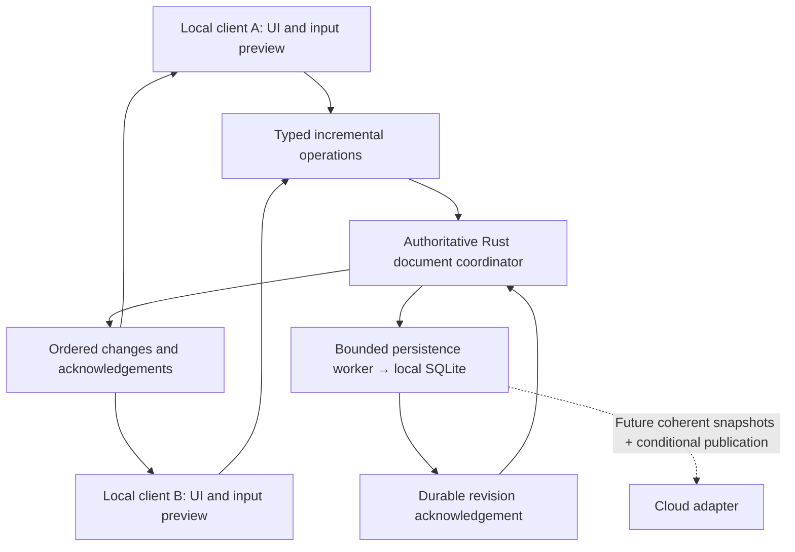

Current transport default: [platform IPC defaults](platform-ipc-defaults.md), selected under owner delegation in decision 182. Older unselected-transport notes are historical; concrete feasibility/security evidence remains required.
Decision 166 (2026-10-16): prioritize preventing data loss over automatically reconciling every edit. Preserve conflicting work and resolve explicitly. Local incremental coordination (163) and platform adapters (164) remain selected. Initial future cloud sync preserves both whole-document versions; automatic semantic merging and object-level conflict review are deferred. Concrete preservation/retention/failure contracts and identified Figma approval remain required; no application implementation authorized.

# Incremental local editing and initial cloud conflict handling

Status: owner-selected planning directions, 2026-10-16 (decisions 163–166). Documentation only. Concrete coordinator placement, IPC contracts, cloud provider/security, schema changes and UI still need review and implementation authorization.

## Selected scope

- DB5: multiple local clients edit one drawing incrementally through one authoritative Rust document coordinator and one local database writer. Supersedes exclusive-one-editable-client interpretations, not the single authoritative mutation invariant.
- DB6: platform communication adapters, subject to feasibility: direct calls within one process, native IPC between native processes, browser messaging between browser contexts. NSXPC is a macOS candidate, not a universal transport.
- Initial future cloud sync: detect divergent versions, preserve both coherent whole-document versions and offer explicit resolution. Automatic cross-device merging is deferred. This is separate from local incremental collaboration and does not authorize cloud implementation.
- watchOS/tvOS/Wear OS/Android TV remain view-only. Additional editing/network capabilities and platform implementations are not implicitly approved.

## Selected hosting — DB10-A / decision 168

The first app process to open a drawing and obtain exclusive authority hosts the coordinator; other local clients connect. No separate service is selected. Closing one window need not end the process, but quit/crash/suspension requires explicit lifecycle handling. On coordinator loss, pause shared mutations and retain pending work under reviewed limits. A timeout is not authority: takeover requires exclusive ownership, durable reload and a fresh ownership generation. Coordinator restart alone does not change the database incarnation selected by DB9-A.

Hosting is separate from execution-thread ownership. Mobile/browser adapters must prove lifecycle/storage support; first-app-process hosting is not a cross-platform always-running-service guarantee. Orderly shutdown, replay/unknown outcomes, exact locks and IPC remain review gates.

## Current conflict/recovery refinements — decisions 177–180

Decisions 177–180 close the current policy batch: DB17-B uses SQLite FULL with fullfsync=OFF and checkpoint_fullfsync=OFF on macOS, without claiming identical cross-platform durability. DB20-A validates whole-stroke mutation state; DB21-A starts a fresh Undo/Redo session after coordinator recovery only after reconciling/preserving pending work; DB22-A permits proven-independent commands and pauses dependent/uncertain ones. Exact schema/ABI/budgets and UI remain review items.

## Pending work, quit, Undo and conflicts — decisions 169–172

DB11–DB14 selected A (decisions 169–172): bounded client-memory retention until durable acknowledgement; orderly save/disconnect/exclusive takeover rather than live transfer; client-scoped conditional Undo; object/property preconditions rather than interaction reservations. No client recovery journal or persistent Undo selected. Uncertain outcomes require reconciliation, not blind replay. All-holder failure before persistence can lose unsaved work.

On ordinary quit, stop admission and settle saves or obtain the reviewed failure/quit resolution before disconnecting and releasing ownership. A surviving client reconnects only to verified new authority. Host process death differs from window closure. A client cannot claim Saved on acceptance alone. Per-operation receipts/reconciliation, inverse/redo safety and reconnect history remain concrete contract work. Conflict UI requires identified Figma approval.

## Responsibility model

Clients own their viewport, selection, tool settings and active interaction/previews. The coordinator owns shared document mutation, capabilities, validation, revision/order and persistence policy. A global active-stroke slot is insufficient. Focus loss cancels only the affected client's unfinished work; other clients retain accepted work.

Independent added strokes can both succeed. Do not reject every independent command merely because the whole-document version advanced; define per-operation preconditions. DB13-A selects client-scoped conditional Undo; DB14-A selects command preconditions without object reservations. Exact transform/delete/paint-order/inverse semantics remain concrete contract questions. No CRDT library, custom binary format or generic command bus is selected.

Render local temporary ink without waiting for IPC or disk. Distinguish local preview, coordinator acceptance, durable local save and cloud sync. Bound client counts, batches, queues, history and resync snapshots; define fairness/backpressure and generation-safe replay. Each client renders through Skia; do not transfer native widgets/GPU objects. Hosting direction is selected by DB10-A; exact executor, lifecycle mechanisms and latency proof remain pending.

## Platform candidates — not implemented support

| Host | Mapping and required proof |
| --- | --- |
| macOS | Direct dispatch in-process; authenticated NSXPC between processes. Prove sandbox/signing/discovery, bounded commands and coordinator failure. |
| iOS/iPadOS, UIKit visionOS 2D | Direct dispatch between scenes sharing an app process; prove per-client lifecycle. Future extensions need a separate design. |
| Android/Android XR/Android route on ChromeOS | Direct dispatch; Binder/AIDL only for deliberately separate processes/services. Prove caller checks, suspension and process death. |
| Windows | Direct dispatch; local named pipes/RPC or suitable app-service adapter between processes. Review access control, interface/framing, packaging and lifecycle. |
| Linux | Direct dispatch; reviewed D-Bus/local socket candidate for separate processes. Prove sandbox/peer authorization and lifecycle. |
| Web/web route on ChromeOS | Same-origin SharedWorker + MessagePort candidate. Prove browser support, profile/storage partition scope, worker termination, one storage owner, Wasm/VFS and recovery. |
| TV/watch viewers | Read/query updates only; shared Rust rejects content mutation. Acquisition/network features remain separately scoped. |

A SharedWorker is not a permanent daemon and cannot join separate devices, origins or browser profiles. Browser storage/locks differ from desktop SQLite. Prove selected SQLite/Wasm VFS and worker/storage topology together; OPFS synchronous access restrictions may require a dedicated storage worker. No VFS dependency is selected or native rusqlite-in-browser compatibility claimed. Shared commands/document semantics do not require identical native ABI or OS transport.

FFI remains in-process; IPC adds a peer-authenticated boundary. Broadcasts are not ownership or durable storage. If a mechanism is unavailable, report a capability gap; do not silently admit two database writers or add a localhost server/daemon. Mobile does not need extra processes for symmetry. Local IPC cannot synchronize desktop and web replicas on different devices.

## Initial cloud-sync policy

Cloud-linked replicas need shared logical identity and a durable last-successful common sync point. Matching names or coincidentally equal local revision numbers are insufficient. Existing external import-as-copy remains unchanged. Exact lineage/token schema awaits review.

Compare the last common sync point with current local durable revision and remote token. If both changed, preserve local work, pause automatic publication and show a conflict. ETag/conditional writes detect changed remote versions but do not merge drawings. Do not merge SQLite pages or synchronize active main/WAL files independently.

Owner selected preservation-first resolution. Proposed Figma scope: inspect either version, keep both as separate drawings, or select which becomes active while retaining the displaced version. These exact controls/layouts still need design approval. Show the exact affected versions and explain which changes will not appear in the selected active version. Publish only against the remote version confirmed; another remote edit invalidates the decision and returns to conflict resolution. Never blindly retry an uncertain publication.

Required direction (166): preserve coherent recoverable local and remote versions before destructive replacement. Concrete snapshot representation, bounds, retention, cleanup consent and recovery behavior remain review items. If protection cannot be completed (including storage/quota failure), block destructive resolution; surface the failure and preserve existing versions. Do not silently evict unresolved unique work or promise unlimited retention. No automatic force override or silent deletion of unique pending local-client work.

Outgoing publication captures a coherent completed snapshot through the local coordinator. Incoming remote replacement must coordinate all local clients, unfinished interactions, accepted unsaved work and Undo histories; recheck local state after confirmation. Timeout after publication means UnknownOutcome: query provider state before retry. Provider conditional-write/version-history/auth/quota capabilities need review. No cloud provider, account, network trust model, new table or operation log is selected.

Pending local commands rejected for staleness must remain recoverable/reviewable within the agreed client lifecycle rather than disappearing. Define bounds and recovery failure behavior before implementation; retained RAM alone does not survive a crash.

## Contract, security and acceptance gates

S02M must define client/coordinator generations, operation IDs, authenticated principals, typed commands/deltas, duplicate/replay bounds, resync, per-client cancellation and accepted/durable acknowledgements. Rename-only receipts and current gallery ABI do not define a complete edit protocol. DB7 copied-output and DB8 macOS readiness choices stay selected within their in-process scope; the wake pipe is not the IPC command transport.

Expand existing peer/FFI/file/recovery/privacy threat review to all editing operations. Validate capabilities centrally, bound hostile messages and reject stale authority; sender-declared IDs are not authentication. Redact content and persistent IDs from diagnostics. Network trust/credentials need separate independent review.

Planned MC-01 simultaneous independent strokes; MC-02 same-object conflicts; MC-03 per-client Undo/selection/viewport; MC-04 duplicate/delayed/out-of-order messages/resync; MC-05 crash/takeover without split authority; MC-06 suspension/focus loss/queue limits; MC-07 viewer/unauthorized peer rejection; MC-08 two browser tabs and worker/storage restart. Native/browser E2E is distinct from Rust simulations. Accepted-but-not-durable work is not promised recoverable without a proven contract.

Future SYNC-01 both replicas changed; SYNC-02 remote edits during confirmation; SYNC-03 local edits during download/replacement; SYNC-04 uncertain result/duplicate retry; SYNC-05 provider lacks conditional writes; SYNC-06 backup/quota failure; SYNC-07 import identity isolation. None implemented or executed.

## Primary references checked 2026-10-16

- https://developer.apple.com/documentation/uikit/scenes
- https://developer.android.com/develop/background-work/services/bound-services
- https://learn.microsoft.com/en-us/windows/win32/ipc/interprocess-communications
- https://dbus.freedesktop.org/doc/dbus-tutorial.html
- https://html.spec.whatwg.org/multipage/workers.html#shared-workers-and-the-sharedworker-interface
- https://sqlite.org/wasm/doc/trunk/persistence.md
- https://www.rfc-editor.org/rfc/rfc9110.html#section-13.1.1

Sources establish candidate mechanisms, not verified Linefield platform support.

## Additional selected scope — decisions 173–174

DB15-A / decision 173 selects bounded durable outcomes for relevant editing commands, atomic with their drawing changes; no full history/client journal/persistent Undo. Missing receipts remain Unknown. Concrete receipt schema/retention/export scrubbing require review. DB16-C / decision 174 defers cloud conflict-copy retention to the cloud milestone without weakening preservation-first decision 166.
