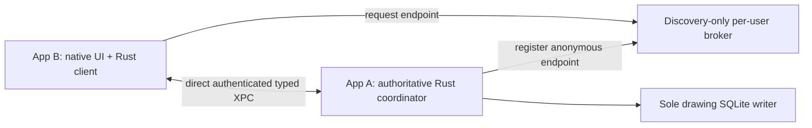

Current transport default: [platform IPC defaults](platform-ipc-defaults.md), selected under owner delegation in decision 182. Older unselected-transport notes are historical; concrete feasibility/security evidence remains required.
# Native IPC, file access and browser storage feasibility
Date: 2026-10-16. Scope: owner-authorized disposable feasibility checks; no product implementation. Background/headless only, synthetic data, no windows, permission prompts or global security changes. Evidence is an early feasibility result, not S02 completion.

## Native result
| Check | Result | What it proves / does not prove |
| --- | --- | --- |
| Typed NSXPC echo and transferred anonymous endpoint | Passed, distinct host/service processes, 41→42 | Native IPC primitives with bundled-service bootstrap; not discovery of independent app processes |
| Wrong code-signing requirement | Expected rejection, Cocoa 4102 | Negative signing check works; positive production Team/app trust not tested |
| Ad-hoc-signed App Sandbox host and service | Typed exchange passed; synthetic outside-container read denied | Baseline sandbox enforcement without broad exceptions; not distribution signing/entitlement validation |
| FileHandle transfer | Passed, 5 synthetic bytes | Unsandboxed descriptor transfer; no proof of user-granted sandbox access |
| Two-process flock | Exclusion while held; takeover after close passed | Cooperative lock mechanics, not abrupt crash/replay/authority-state implementation |
| Duplicated descriptor and path replacement | Original bytes retained, replacement inode differs | Descriptor owns an opened object; pathname alone cannot identify replacement safely |
| O_NOFOLLOW | Synthetic symlink rejected | Final-component check only; not a complete multi-component path traversal proof |
| Ordinary bookmark | Same canonical fixture resolves | Not security-scoped grant persistence or revocation proof |

Environment: macOS 27.0.1 (26A434), arm64; Xcode 27.0 (27A266a). Initial CLT/private-cache failures are retained. Explicit paired Xcode compiler/SDK and a private module cache compiled successfully; global developer-directory selection unchanged. Tool sandbox initially denied XPC lookup; scoped execution outside that tool sandbox succeeded. Tool sandbox and macOS App Sandbox are distinct.

Fixture service accepts incoming connections intentionally and is not production-safe code. No product command ABI, class allowlist, rate limit, receipt, identity or recovery implementation was tested. The service exists only inside a disposable probe bundle; this does not introduce a Linefield service/daemon.

## Remaining native gates
1. Independent sandboxed app-peer rendezvous. Anonymous endpoint transfer needs an existing channel. App Groups alone are not discovery. Review exact namespace, Team/app identity, endpoint exchange and shutdown behavior; preserve first-app coordinator ownership. Do not quietly replace it with a broker or singleton bundled service.
2. Production authentication in both directions, allowed Objective-C classes, actual encoded/decode-size bounds, admission/replay/authority-generation checks and upgrades.
3. User-selected persistent file access: native panel grants, balanced security-scope lifetime, process restart, stale bookmark, revocation and destination replacement/provider races. An unsandboxed bookmark success does not close this gate.
4. Lowest supported macOS runtime and App Sandbox build/signing matrix.

Next safe sequence: a concrete native rendezvous/entitlement proposal for owner review; then a signed independent-peer experiment. Persistent file-grant checks need a bounded foreground session and native panels, so request desktop reservation before those checks. App Group/team credentials or registration must not be invented. Continue background review while that evidence is unavailable.

Sources: [Apple endpoint](https://developer.apple.com/documentation/foundation/nsxpclistenerendpoint), [App Groups](https://developer.apple.com/documentation/bundleresources/entitlements/com.apple.security.application-groups), [sandbox file access](https://developer.apple.com/documentation/security/accessing-files-from-the-macos-app-sandbox), [signing requirement](https://developer.apple.com/documentation/foundation/nsxpcconnection/setcodesigningrequirement(_:)). The installed SDK declares the signing-requirement method from macOS 13; API availability alone does not set Linefield minimum OS.

## Discovery decision IPC1 — new owner review required
Apple DTS documents that ordinary apps cannot publish a supported named XPC listener directly. The name must belong to a launchd-advertised job; an App Group only grants access, not registration. A bundled XPC service is not a shared rendezvous for separate app instances. This is a real gap in the selected first-app-hosted plan, not just an untested configuration. See [Apple DTS explanation](https://developer.apple.com/forums/thread/715338) and [listener API](https://developer.apple.com/documentation/foundation/nsxpclistener/init(machservicename:)).

| Option | Keeps first-app drawing coordinator? | Cost / approval needed |
| --- | --- | --- |
| A: discovery-only per-user LaunchAgent broker — recommendation if independent-process clients stay in first scope | Yes; broker exchanges endpoints only, direct authenticated XPC carries commands | Adds a registered service and its signing/installation/lifecycle/security work. Must amend the no-extra-service constraint explicitly before a probe registers anything |
| B: App Group Unix-domain socket | Yes | Requires a reviewed framed message representation, credentials/authentication and socket lifecycle. Typed in-process FFI remains, but this is a new transport contract, not a shortcut around review |
| C: defer independent-process editing for the first preview | Single-process shared Rust commands remain; multi-client policy deferred | Less operational machinery, but changes owner-selected first-preview coordination scope and cannot be assumed |

All three remain unselected. A preserves typed native XPC and avoids a bespoke socket command format, but its operational cost is real. No broker was installed, registered or started by the completed probe.

Proposed option A, not implementation:

The broker must never own artwork, revisions, SQL connections or editing authority. Its restart cannot confer document ownership; the existing lock/identity protocol still decides authority. The actual broker contract must cover identity, registration races, stale endpoints, restart, bounded storage and uninstall before code. A scoped temporary registration experiment requires owner approval of that change and explicit cleanup; it is not covered by the already-completed bundled-service test.

## Browser result
| Engine | Executed API checks | Result |
| --- | --- | --- |
| Chromium 153.0.8010.12 | Dedicated-worker OPFS write/flush/close/reopen, exclusive contention between two pages, release/takeover, new-page read; Web Locks | Passed in disposable headless context |
| WebKit 27.2 | API exposure and Web Locks; OPFS access attempt | Web Locks passed; OPFS returned UnknownError; cause unresolved |
| Firefox | No available cached executable | Not run; no download |

Node 24.12.0/Playwright 1.64.1 with explicitly selected older cached engine revisions 1243/2359, not package-matched binaries. Therefore these results are preliminary. Headless WebKit is not a released Safari acceptance run. Contexts were fresh/ephemeral; no existing profiles, persistent-storage request or permission prompt. Browser contexts were closed.

This tests primitives, not SQLite/rusqlite/Wasm/VFS/WAL integration, crash recovery, browser-process restart, quota exhaustion, eviction or physical durability. Successful new-page reopen occurred in one browser lifetime. Two contexts are not claimed to be separate OS processes. No permanent origin or application data was created.

The next browser lane should use matched pinned engines and a persistent disposable profile for restart/crash cases, then compile the candidate Rust/Wasm backend and test one authoritative writer/two clients with exact same schema/conformance fixtures. Select VFS/worker lifecycle only after review; do not duplicate live SQLite connections accidentally. Official SQLite OPFS WAL support has different locking tradeoffs from native WAL.

## Evidence and coverage
Raw source/evidence snapshots are archived under artifacts/feasibility/2026-10-16/. Reproducible source hashes and results index: [S02 feasibility evidence](../../quality/S02-feasibility-v1.json). Temporary originals were /tmp/linefield-native-feasibility and /tmp/linefield-browser-feasibility; archived source contains explicit temporary paths and reference-tooling provenance, not application dependencies.

Related planned cases: S02V2-03/04/09/10/12/21/22/26 and MC-01–08. Primitive passes do not mark these full application scenarios passed. Root pnpm check passed type/lint/format/script-size; it does not validate disposable Swift/browser probes. Source-size and executed compilation are recorded separately; standalone TS probe strict type/lint gates were not run.

[Engineering-budget review](../reviews/engineering-budgets-v1.md) contains approved limits versus the remaining recommendations. No performance benchmark or physical input latency test ran. Fresh independent review is recorded in the evidence file when completed.
