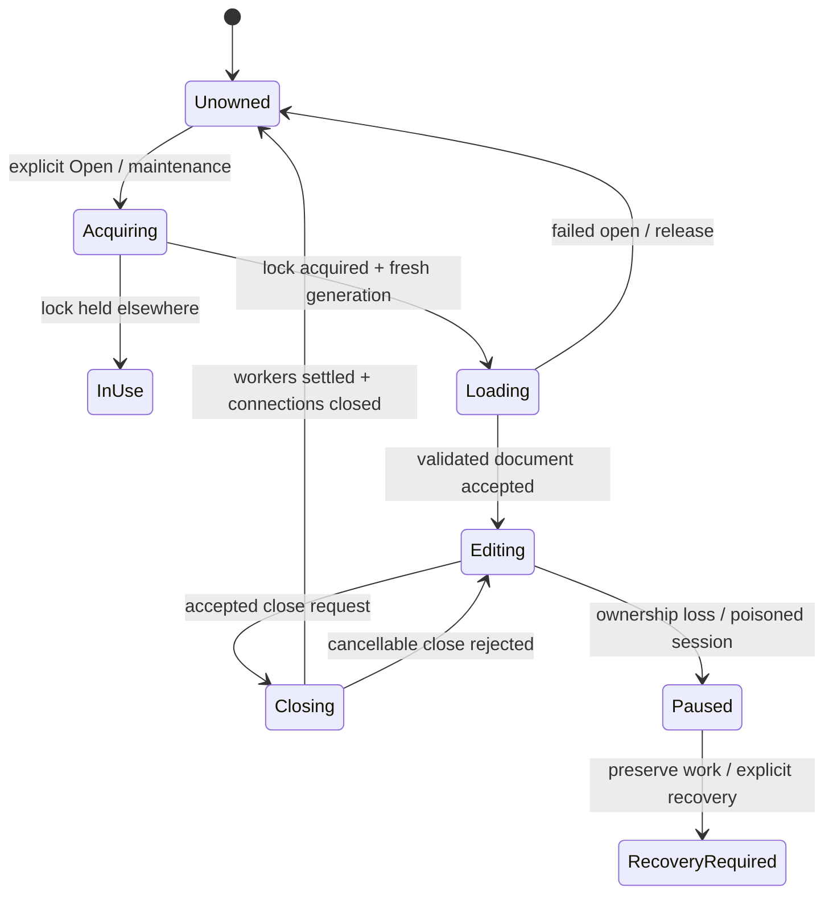
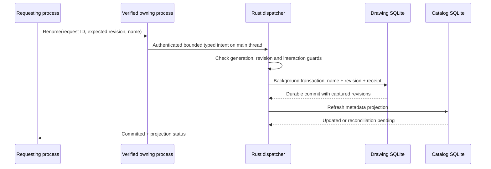

Current proposal: [S02 consolidated v2](../reviews/S02-consolidated-v2.md). This older draft is historical where v2 differs; its pending-choice notes must not reopen decisions through 180. No implementation approval is implied.

Scope update: decisions 163–164 permit multiple editable clients through one authoritative coordinator. Ownership protects coordinator/database-writer authority, not exclusive use by one UI. Expand this rename-only draft under S02M; exact mechanisms remain proposals. See incremental-collaboration.md.

# Ownership and cross-process rename — proposal v1

Status: unapproved concrete design, documentation only. CT-01/03/04/05/07, INV-01/06/09.
Existing policy permits separate processes editing different drawings, with one mutable owner per drawing.

## Ownership

Use a stable dedicated lock file derived from validated managed identity, separate from the
replaceable drawing database. Acquire an exclusive nonblocking OS advisory lock before opening
a mutable editor, renaming an unowned drawing, upgrading or deleting. Never unlink/replace an
active lock inode. Never take over because a heartbeat expires, a PID disappears or a notification
is missed. Processes must cooperate; this is not protection against an attacker with raw file access.

On acquisition assign a fresh owner-generation UUID and process-instance UUID. PID is routing
information, not authority. Worker work carries document ID, owner generation, session generation,
operation and captured/base revisions. The storage job retains the ownership guard until its
transaction commits or rolls back. A generation check alone cannot cancel a transaction already
committing; holding the guard prevents another compliant owner from acquiring during that interval.

Closing stops admission, cancels unfinished interactions, settles accepted work, closes connections,
then releases ownership. Genuine ownership failure pauses mutation/persistence and preserves
accepted unsaved RAM state where possible; no silent reacquisition and flush.

Contested explicit Open can activate the verified owning window if supported; otherwise report
in-use. Background refresh must never steal focus. One window per app instance remains unchanged.

## Transport alternatives

| Mechanism | Fit | Remaining problem |
| --- | --- | --- |
| Authenticated typed NSXPC | Recommended candidate: native IPC, restricted typed methods and peer signing checks | Sandbox endpoint rendezvous must be proven |
| SQLite request table + advisory notification | Durable and easy to inspect | Shared-container write access becomes trust boundary; self-declared process UUID is not authenticated peer identity |
| Launch-agent broker | Shared rendezvous | New service topology/deployment; unselected |
| Embedded XPC service as singleton | Not a valid assumption | Apple describes per-client service instances |

An anonymous XPC endpoint needs an existing channel to reach the peer. App Groups alone do not
solve listener registration/discovery. Validate supported APIs, signing requirements and minimum
OS in a two-process sandbox probe before choosing transport. Do not generate a speculative binary protocol.

Sources checked 2026-10-16: [Apple XPC](https://developer.apple.com/documentation/xpc),
[App Groups](https://developer.apple.com/documentation/bundleresources/entitlements/com.apple.security.application-groups),
[Mach listener limits](https://developer.apple.com/documentation/xpc/xpc_connection_mach_service_listener),
[flock](https://developer.apple.com/library/archive/documentation/System/Conceptual/ManPages_iPhoneOS/man2/flock.2.html).

## Narrow typed operations

These are semantic fields, not encoded packets or implemented Objective-C declarations.

- Rename(request UUID, library UUID, document UUID, target owner generation,
  expected metadata revision, bounded UTF-8 new name, requester instance for correlation).
- QueryRenameOutcome(request UUID, document UUID, target generation).
- ActivateOwnedDocument(request UUID, document UUID, target generation), explicit user origin only.

Authenticated principal comes from the connection, never payload fields. Verify allowed application
identity/signature, library/document authority and generation independently. Restrict XPC classes,
sizes and rates. Worker-queue callbacks enqueue bounded intent for the main-thread dispatcher;
they never mutate editor state themselves. No arbitrary SQL/path/general execute-command API.

Outcome is Committed(revision, catalog projection status), Conflict, Rejected, OwnerChanged,
Busy or Unavailable. Connection loss is UnknownOutcome, never proof of failure.

## Rename and receipts

The receipt keys request UUID plus owner generation and stores a fingerprint of validated arguments,
expected/result metadata revisions and committed result. Names/fingerprints are private data and
never diagnostics. Same request/same arguments returns the receipt; different arguments reject.
A request based on stale metadata revision conflicts. No automatic fresh-ID retry after a lost reply.

Propose at most 4,096 admitted rename receipts per ownership generation, 8 MiB total receipt budget,
and one retained previous generation for queries. These are **provisional review limits**, not
selected requirements. At exhaustion reject admission; do not evict an executable request's receipt.
After generation change old requests cannot execute; retained queries may confirm, missing receipts
return Unknown. No promise of indefinite historical exactly-once delivery.

Receipts are local service metadata stored with the drawing for atomicity. Native exports/imported
copies omit them. DB3-A selects multiple bounded receipts over last-receipt-only; numeric budgets, expiration and generation retention remain pending. An expired/missing receipt is an unknown outcome, never permission to repeat the rename blindly.

## Fencing and lock order

Proposed ordering: acquire drawing ownership, then short library mutation coordination, then
individual database transactions sequentially. Never await native UI or peer replies while holding
a SQLite transaction or library-wide mutation lock. Export source deletion and snapshot-job admission
use the same library mutation coordinator, so no export can slip between dependency check and
deletion intent. Existing owners are checked without acquiring their held drawing lock; reject busy.

Destination publication has its own stable canonical-destination lock. It must not acquire a
drawing lock while held. Do not infer destination sameness from display text or uncanonicalized paths.
Exact native target identity/grant rules remain an interface-security follow-up.

## Probe acceptance, not yet executed

Two independently launched signed sandboxed instances must demonstrate authenticated discovery,
wrong-peer rejection, owner activation, crash lock release, no stale commit after guard release,
no lost wake, and owner death before/after rename commit/reply. Record the actual APIs/entitlements,
minimum OS and signature configuration. No private API or broad temporary entitlement fallback.
