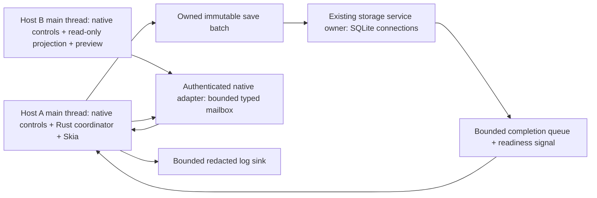
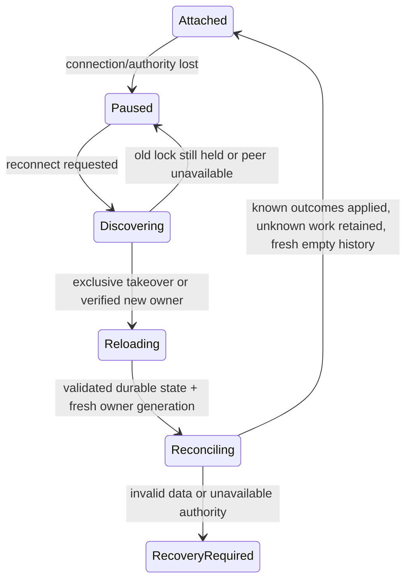

# S02 v2 authority, transactions and recovery
Status: concrete proposal approved by owner (decision 181). Supersedes exclusive-client/rename-only portions of ownership-rename-v1.md; retains existing supported-migration and export policies. CT-01/03/04/05/07, INV-01/04/06/09/10.

## Threads and authority

No new executor or standalone service. One authoritative coordinator mutates each document on its hosting process main thread. Every client has its own interaction/selection/viewport/history; remote preview is not another writable document. Native callbacks enter shared named Rust commands. IPC callbacks authenticate/copy/enqueue only, never mutate. Skia/native widgets remain local. Background storage retains lifetime authority guard through commit/rollback.

Stable lock-file identity is separate from replaceable drawing DB; never unlink an active lock inode. Proposed macOS advisory exclusive lifetime lock; old owner release confirmed by successful acquisition, not PID/heartbeat timeout. Exact signed/sandboxed endpoint discovery still requires a native probe. Same-process calls use direct dispatch. Peer self-declared UUID/origin is not authentication.
Ordering: drawing authority → short library mutation admission → one database transaction at a time. No library/SQL lock across UI, IPC reply or slow render. Destination lock never acquires drawing lock; staged immutable export releases source authority before publication. Deletion/export admission share the library coordinator; multiple destinations follow canonical deterministic ordering or one-at-a-time.

## Completed edit and acknowledgement
```mermaid
sequenceDiagram
  participant C as Client main thread
  participant O as Coordinator main thread
  participant S as Storage owner
  participant D as Drawing SQLite
  C->>O: Named command + session/sequence/operation + stroke token
  O->>O: Validate authority, dependencies, token and reserved capacity
  O-->>C: Accepted (not Saved); retain exact pending command
  O->>S: Immutable ordered changes + base/target versions + receipt
  S->>D: BEGIN IMMEDIATE; compare incarnation + durable base
  S->>D: Changes + revision pair + command receipts
  D-->>S: Synchronized COMMIT or failure/unknown
  S-->>O: Identity-bound durable acknowledgement
  O->>O: Reject stale completion; advance only captured durable revisions
  O-->>C: Durable outcome + current/durable version pair
  C->>O: Contiguous incorporated-outcome acknowledgement
```
Validated sequence floors prevent a pruned operation from executing again. Capture content timestamps at semantic acceptance; durable completion is not edit time. Rename increments metadata only. A save batch may contain several operations but each keeps its own receipt/history boundary. Reject/rollback entire SQL batch on persistence-base mismatch; live accepted work remains pending, not silently rolled back or declared saved.
No-op/rejection outcomes are bounded session-memory results; after owner loss they can become Unknown. Never infer execution from current state or replay under a new UUID. Queries of old receipts use newly authenticated current authority; old execution credentials stay invalid.

## Coordinator loss and reconnect

Old interaction handles/events never resume. Cancel unfinished preview per client; preserve completed pending work in the surviving client. Durable receipt resolves committed operation; missing receipt keeps its proposal in bounded unresolved state, separate from Undo. Initial proposal does not automatically reapply unknown content or add a salvage/merge screen. Approved conflict/recovery UX must expose actionable preservation paths before implementation.
Fresh local handles and history generation; fresh Undo/Redo even if artwork is unchanged. Ordinary owner restart keeps database incarnation. Controlled DB replacement creates new incarnation and requires exclusive file-handle coordination before publication. DB token alone does not fence arbitrary external file replacement.
Orderly quit: stop admission, cancel unfinished interactions, settle pending saves or reviewed quit failure/consent, notify/disconnect peers, close SQL, then release authority. Never join slow workers on UI thread. Forced kill/power loss can lose RAM-only work. No live coordinator transfer.

## Cross-database transitions
| Operation | Authoritative durable checkpoints | Crash/error reconciliation |
| --- | --- | --- |
| Create/draft | Catalog reserve UUID/name ordinal + lifecycle → drawing staging validated → filesystem publish → catalog item | Resume exact intent/identity; ordinal gaps okay; never show partial file. Missing authority blocks guessing |
| Rename | Drawing name/revision/receipt → catalog projection | Drawing commit remains durable if index update fails; repair known incarnation/current version; late projection cannot roll back metadata |
| Content edit | Drawing revision/receipts → catalog recency projection | Allocate activity only when newer source content revision is projected; retry same incarnation/revision is idempotent. Coalesced revisions get one projection ordinal; lost historical arrival order is not reconstructed |
| Import | Coherent bounded source capture → validate → fresh IDs/incarnation/empty receipts → create sequence | Source unchanged; independent copy, never inherit execution authority or mix source revisions |
| Upgrade | Eligible exclusive ownership → verified pre-upgrade copy → transactional supported migration → validation → catalog refresh | Copy failure blocks mutation; retain previous protection until new copy and upgraded file validated; keep latest successful pre-upgrade copy |
| Restore | Validate protected copy → independent import with new IDs/incarnation | Preserve damaged original; no in-place salvage. A future controlled replacement uses different explicit consent/fencing |
| Delete | Exact confirmation + durable catalog intent → prevent new exports/clients → settle/cancel existing dependencies → remove verified managed files → finalize | Resume only proven confirmed target/incarnation; missing lifecycle authority is not deletion consent. Busy foreign ownership blocks |
| Export | Source reserved on command before panel → native grant → snapshot + job durable → claim → stage → destination lock/consent → publish → verify → terminal → cleanup | Unknown publication pauses; inspect provider/target state before retry. Do not redirect or recapture newer artwork. Separate DB updates are not atomic |
| Maintenance | Singleton library maintenance owner + per-drawing exclusive ownership → reserve bounded work/space → verify SQLite operation | Skip active drawings; timeout never steals authority; interrupted work reconciles exact identities |
| Catalog authority loss | Preserve files, load trustworthy recovery authority if available | Rebuild only recoverable projection; do not guess naming/deletion highwaters or introduce fourth DB |

Catalog source incarnation switch requires current file/owner verification; differing UUID is not proof of newer state. Projected activity_order uses shared persistent allocator, not timestamps; if a later accepted edit is not yet persisted it remains pending. Fixed metadata/current document rows are authority, not catalog caches.

## Failure classifications and retained work
Busy: bounded background retry. Capacity/disk full: preserve pending, stop admission at reviewed bound, report failure. Permission revoked: stop access, native grant retry only after user action. Conflict: no mutation; retain proposal and pause dependencies. Corruption/unsupported format: no automatic rewrite; isolate damaged document and offer existing reviewed recovery. Unknown commit/publication: reconcile evidence, no blind retry. Poisoned editor: no further mutation/persistence from possibly corrupt state; surviving immutable completed jobs need explicit identity validity, never assume catch-panic makes state safe.
A conflict on stroke X blocks its queued dependants; unrelated commands only proceed if the engine proves independence. Successive same-client stroke additions depend on earlier additions for paint order. Dependency declarations cannot override engine-derived footprints. Atomic groups remain all-or-none.

## Diagnostics and security changes
Record central command.admitted/rejected, storage.commit.started/completed/failed, authority.changed, receipt.unknown, client.reconcile, history.reset, capacity.blocked, projection.resync and maintenance.deferred with ephemeral correlation IDs, numeric reason, duration and revision deltas. No persistent UUIDs, name/path, SQL parameters, samples, access grants or fingerprints. Bounded off-thread sink; overload counters never fail an otherwise successful edit.
Sensitive change: authenticated peer boundary now admits edits, not only rename. Require independent review of class allowlists, peer identity, replay/window exhaustion, stale authority, arbitrary native handle injection and private export leakage before code. Native endpoint bootstrap is a feasibility gate, not an approved workaround. Future cloud trust and retention deferred.
