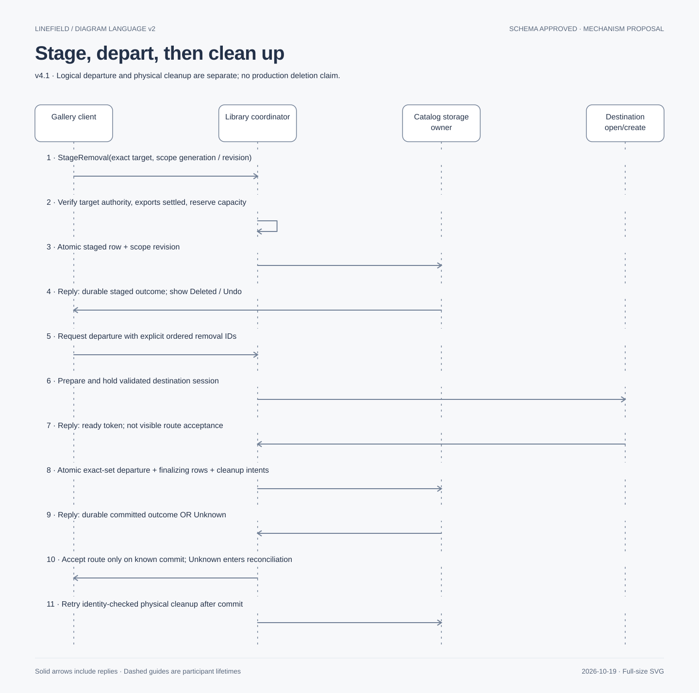

# Durable gallery removal amendment v4.1

Current status: **schema shape approved by decision237; mechanisms proposed and not implemented.**
Presentation/tooling superseded by decisions239–240; original review bytes remain in Git history.
Base fbcc30ca115d630d6c9e688b1525d3ee1dcc89d7 plus preserved uncommitted work. Database specialist
owns this directory; lead integrates Rust, designer, security and independent review. No executable
DDL, application code, hosted publication or dependency installation is included.

The owner approved D1–D3 recommendations in [the decision agenda](../../reviews/library-engine-next-decisions-2026-10-19.md):
durable library first; reversible Deleted/Undo placeholders survive restart; only an exact-set
logical departure commit after destination readiness ends Undo. Those policies do not approve
this proposal's tables, scope ownership, limits, signatures or browser storage mechanisms.
Preserve [v3 approval](../../reviews/S02-v3-approval-2026-10-17.md) and its source snapshots.
Three databases remain; only the catalog changes. Drawing/jobs schemas and regional storage do not.

## Before / after and visual review assets

Before: catalog.lifecycle describes confirmed deletion and its cleanup. The immediate recoverable
tap introduced by decision212 cannot be represented as that destructive authorization.
After: three catalog tables distinguish a gallery removal scope, individual recoverable removals,
and a committed exact departure set. Existing lifecycle rows remain responsible for post-commit
physical cleanup. No ordinary Delete confirmation, generic Trash screen, document edit-history
persistence, new writer, cross-file SQL FK, custom wire protocol or recovery journal is added.

[Historical catalog amendment](https://github.com/AlexandrLesiv/Linefield/commit/b0cb531) contains the complete unchanged v3 catalog context plus
the proposed three tables; it is not a complete three-database release schema. Its table notes
form the conceptual model: one scope owns zero or more removals and at most one departure;
one departure covers one or more removals. [Historical catalog layout](https://github.com/AlexandrLesiv/Linefield/commit/b0cb531)
records proposed layout, not a CLI-exported or hosted-verified diagram. The lead composed the
complete [Historical review schema source (historical)](https://github.com/AlexandrLesiv/Linefield/commit/b0cb531), retaining the previous three-database context and appending
the proposed catalog tables. Both standalone and combined schema source passed the pinned CLI validation
on2026-10-19 using ordinary authorized CLI access, not strict credential isolation. Hosted
publication/privacy/layout remain separate evidence; see the current review handoff. No local
rendered ER export is provided. See [CLI policy (historical)](https://github.com/AlexandrLesiv/Linefield/blob/e08f304/docs/database/cli.md). schema source is documentation, not migrations.

## Authority, visibility and recovery ownership

**Proposed:** each accepted gallery visit has a runtime-generated `scope_id`; the scope is bound
to the current catalog incarnation. Authenticated library clients receive an in-memory grant
from the existing library coordinator. A UUID is an identifier, never a bearer capability.
`claim_generation` increases on an explicit exclusive reclaim. Runtime session identity and
the generation must match every mutation; old commands cannot acquire a scope by naming it.
The persistent row does not store a permanent process identity or promise crash-live grants.

One live client holds a scope. Other galleries observe staged items at their existing activity
position, with unavailable removal status; their Open, rename, Delete and Undo are disabled for
that item. They may use unrelated items. They cannot finalize another live scope. This is a
new proposed presentation/authority rule, requiring designer and owner review, not an existing
multi-client approval. The holder retains independent Undo per item and no layout reflow.
Projection pages include these placeholders; stage does not change name, content or activity order.
No full-gallery materialization or durable pixel/index positions are needed.

On worker/coordinator loss all grants retire. Reconnection first reconciles durable operation
outcomes, then obtains a fresh verified runtime grant. The first authenticated gallery client
may reclaim an orphan open scope atomically; simultaneous attempts have one winner. Other
clients keep the unavailable presentation. Reclaim requires proven prior grant retirement or
exclusive coordinator takeover; heartbeat timeout, PID reuse or tab invisibility cannot confer
authority. Same-process reload requires verified channel retirement. Browser proof is outstanding.
If several orphan scopes exist, expose a bounded recovery choice through the designer's state
packet; never silently combine their departure sets or let one tab delete another live scope.

### Scope acquisition is not a durable mutation receipt

CreateRemovalScope and ClaimRemovalScope are **acquisition operations**, separate from the
receipt-backed Stage/Undo/Commit commands below. They have no durable per-request outcome row.
The coordinator serializes acquisition for each authenticated session request through its bounded
runtime request window; repeating a request queries that window, never inserts or increments again.
Create generates one fresh scope ID and durably inserts its open row at generation/revision zero
before delivering a grant. Claim compares the observed open row/generation/revision and atomically
increments generation and revision before installing the new runtime grant. Claims cannot create
missing rows. The row records current fencing state, not which historical request/client succeeded.

For a lost Create/Claim reply while that coordinator/session survives, query the runtime acquisition
result and validated current grant. An in-flight or uncertain catalog commit must settle/reconcile
before any fresh acquisition for that request or scope; do not issue a replacement request blindly.
If the runtime result is no longer available, return Unknown: row existence or a larger generation
cannot establish the old request's success or grant ownership. After proven grant retirement or
exclusive coordinator takeover, enumerate/reconcile the durable open scopes and explicitly acquire
one through a **fresh** authenticated claim with the current row preconditions. This new claim may
advance the fence even if an earlier undelivered claim committed; that is safe retirement followed
by new acquisition, not replay or reconstruction of a historical successful grant.

A lost Create reply may leave an empty orphan scope. Lost delivery alone does not prove emptiness:
query and validate its rows under exclusive authority before retiring it as empty. Preserve/reconcile
any nonempty scope under the same bounds and explicitly claim it. Do not claim the old Create succeeded,
silently create a duplicate on retry, or discard a nonempty scope. Capacity/recovery UI remains
available if orphan rows fill the bound. A fresh gallery visit after reconciliation can create a
new scope only as a separate admitted action. Execution grants are runtime-only and never restored
from imported files or catalog text. Retired credentials cannot acquire scopes; missing scope
lookup is Unknown and never permission to replay old commands.

## Target protection and command outcomes

Stage uses the existing drawing authority guard followed by short library mutation admission.
Busy foreign editing ownership rejects; no eviction, forced save or queued destructive consent.
Require validated document UUID, managed-file identity, database incarnation and exact revision
pair. Under that guard, finish admission of existing source jobs or obtain their already-required
explicit cancellation consent and durable cancellation result; no jobs-DB atomicity is assumed.
Cancellation remains its own accepted action even if later staging fails. The source bytes stay.

Before stage commit, in-memory admission prevents racing Open/export/rename/upgrade/restore;
after commit the catalog active-removal record is the durable fence. Every future operation
that could acquire, replace or mutate that target checks the fence under the same existing
library admission authority. Reads needed to validate/protect recovery are permitted. No live
document connection remains eligible to save behind the fence. Late completions are rejected.
After restart install durable fences before accepting target operations. Unrelated targets remain
available; the catalog is not another mutable artwork owner. Browser lock/flush proof remains
the storage packet's responsibility and is not established by these sequences.

Typed semantic operations to specify in the library interface packet: CreateRemovalScope,
ClaimRemovalScope, StageRemoval, UndoRemoval, PrepareDeparture, CommitDeparture and QueryRemovalOutcome.
These are proposed names, not approved ABI declarations. StageRemoval, UndoRemoval and
CommitDeparture validate authenticated scope/generation, catalog incarnation, request identity
and expected scope revision. Create/Claim follow the acquisition contract above; PrepareDeparture
creates only a bounded runtime readiness reservation, not a durable success receipt, and must be
prepared afresh after its grant/reservation is lost. Query operations do not confer authority. Stage's
`removal_id` is its operation ID; Undo's `undo_operation_id` identifies its one terminal restoration;
`departure_id` identifies the exact departure request. Retried IDs with different validated bodies
reject. Successful outcomes are reconciled by stored IDs, never inferred from current appearance.
Canonical request fingerprints use the reviewed semantic recipe with a new explicit versioned
domain; exact vectors and byte representation belong in the typed-boundary packet. IDs/digests
are private service state, not diagnostic correlation IDs.

## Transactions and departure boundary

All catalog changes below use one SQLite transaction on its existing storage owner. DDL is not
executed here. `scope_revision` increments once per accepted non-no-op stage/Undo/claim/commit,
checked for overflow; stale expected revision rejects without changing any row.

Presentation migrated under decision239; original approved source bytes remain at commit e08f304.

1. **Stage:** insert staged removal retaining immutable target IDs/revisions and gallery display
   metadata through the existing drawings row; increment scope revision. Do not remove files,
   row or preferences. Failure rolls back stage and releases transient protection; no placeholder
   success. A commit with lost reply is queried before enabling any conflicting action.
2. **Undo:** validate staged status, generation, exact target and known file validity under the
   protection guard; atomically mark restored, store Undo ID/fingerprint, increment scope revision.
   Only a known commit releases the durable target fence. If the file is missing/changed, preserve
   the staged record and bytes that remain; show restoration unavailable rather than invent artwork.
3. **Prepare:** hold a validated destination session under existing open/create semantics without
   accepting the route. A newly created durable drawing remains an ordinary library item if later
   departure fails; do not delete it as rollback or reuse its ordinal. Release only temporary handles.
4. **Commit:** exact nonempty staged set must equal all staged removals in this scope at the
   expected revision, canonical ordered by removal ID. Destination cannot be in that set. Reserve
   the destination session through commit admission; no slow destination/filesystem work inside SQL.
   In one catalog transaction insert departure row, attach exactly those removal rows as finalizing,
   insert one existing lifecycle cleanup intent per member, close scope and increment revision.
   Recheck target tokens and valid cancellation/ownership evidence before admission. No partial set.
   A route with no staged removals uses ordinary navigation; it does not fabricate a deletion receipt.
5. **Result:** durable departure commit is the acceptance boundary. Undo is now unavailable even
   if reply/animation/editor presentation fails. Unknown must freeze contradictory actions and
   query the durable record; do not report definitive failure/Stay-with-Undo. A proven rollback
   keeps all placeholders undoable. If destination subsequently fails, explain the accepted removal
   and destination failure separately; do not resurrect Undo or claim physical cleanup succeeded.
6. **Cleanup:** verify departure membership, lifecycle operation identity, managed locator,
   document/incarnation/revision and exclusive file authority before deleting only that target's
   approved managed file set. SQLite sidecars/connections follow existing safe-close rules; never
   unlink a live lock. After deletion, transactionally remove drawing/projection/preferences and
   mark removal cleaned. Filesystem success plus catalog failure resumes the exact intent. Missing
   file alone is not success until the complete approved target set and absence are reconciled.

Browser unload/reload/backgrounding issues no CommitDeparture. No asynchronous unload promise.
Restart with staged rows restores placeholders; restart with committed departure resumes cleanup.
Corrupt/missing catalog authority preserves files and treats deletion as unresolved, not permitted.
No scene transition, wall-clock expiry, catalog projection or receipt absence substitutes for authority.

## Dictionary and constraints

All new tables are STRICT; UUID BLOB values require length16, fingerprints length32; revisions
and generations are nonnegative signed i64 with checked increments. No new timestamp field.
All new fields are NOT NULL except explicitly optional state-specific fields in schema source.

| Table / fields | Meaning and validation authority |
| --- | --- |
| removal_scopes.scope_id, catalog_incarnation | Durable visit identity; Rust verifies current catalog binding; PK uniqueness SQL |
| claim_generation, scope_revision, state | Exclusive runtime claim fence; optimistic command guard; open/committed only; enum/check SQL, transitions Rust |
| removals.removal_id, scope_id, stage_fingerprint | Stage request identity/body and parent; SQL PK/FK; immutable after stage |
| document_id, managed_file_id, database_incarnation, content_revision, metadata_revision | Exact protected source; immutable; logical cross-file relationship, Rust validates; no FK to drawings because terminal outcomes survive deletion |
| removals.state | staged/restored/finalizing/cleaned; SQL enum; legal transition and fence admission Rust |
| undo_operation_id, undo_fingerprint | Both present iff restored; stable lost-reply outcome; SQL CHECK and unique non-null operation ID |
| departure_id | Present iff finalizing/cleaned; same-scope departure FK proposed in companion schema source; exact membership/count checked by Rust inside transaction |
| departures.departure_id, scope_id, argument_fingerprint | Committed request/body; PK, unique scope; one departure per scope; immutable |
| destination_document_id, destination_database_incarnation | Already-ready destination identity; logical reference, not permanent readiness or cross-file FK |
| result_scope_revision, removal_count | Commit result and exact member count; positive; SQL domain CHECK; equality against scope/members Rust |

SQL indexes: partial UNIQUE removals(document_id) WHERE state IN ('staged','finalizing') prevents
two active removals of one library identity; INDEX(scope_id,state,removal_id) supports bounded sets;
INDEX(departure_id,removal_id) supports reconciliation. the historical review representation omitted executable partial predicates,
so prose/actual migration introspection are mandatory. Enforce departure scope consistency with
UNIQUE(departure_id,scope_id) and composite FK from removals; all new FKs delete/update RESTRICT.
Existing drawings deletion still cascades only existing view/pen preference rows. No cascading
deletion of recovery/receipt material. `lifecycle.operation_id = removal_id` for the cleanup intent;
operation_kind proposed `gallery_remove`, phases start only after departure commit. Its non-null
expected target/revision fields must match the immutable removal; confirmed_utc_us remains NULL:
the departure record, not fabricated confirmation/time, authorizes this new operation kind.

## Bounds, pruning and tradeoffs — proposed, not measured

Propose at most 64 retained scopes, 256 total retained removals and 64 departures per library,
and 8 MiB charged logical rows/index/request-set memory, nested in existing process budgets.
These new library-wide capacities need owner review; existing per-drawing client caps are unchanged.
Reserve cleanup/receipt rows and control capacity before Stage; departure moves reserved capacity,
so approaching the cap does not force loss of Undo/reconciliation. Stop new Stage/scope admission
when protected data fills capacity; queries, Undo and already-reserved finalization remain usable.
Account actual allocations and SQLite disk/WAL separately; byte/row bounds are not disk guarantees.

No time-based deletion, automatic scope adoption or unbounded persisted history. Terminal restored
or cleaned rows can retire only when their execution scope is closed/retired, no live request can
reuse it, required outcomes are acknowledged or credentials retired, and all lifecycle/departure
dependencies are reconciled. Open scopes with restored rows may be explicitly retired when no
staged items remain; retirement is runtime authority revocation before record cleanup. Never prune
staged/finalizing/unknown outcomes to gain admission. Missing old outcome is Unknown with stale
execution credentials rejected. Loss of the catalog cannot establish either confirmation or success.

Tradeoff: three small explicit tables add catalog complexity but make reversible state, exact-set
acceptance and lost replies inspectable. Reusing lifecycle phase plus nullable fields is smaller
but overloads preexisting confirmed-delete authority and lacks an independent exact-set receipt.
A library-global Undo set is simpler but lets one tab finalize another live gallery's removals;
per-scope ownership avoids that at the cost of reclaim/unavailable presentation. Neither alternative
is silently selected by D2/D3. Native quit remains outside this browser amendment.

## Edge-case acceptance, security and test ownership

CT-01/05/07/08, INV-06/07/09, SU-21; reuse LIBRARY-DELETE-001, LIBRARY-FAILURE-001,
LIBRARY-NAV-001. All rows below are **planned / not implemented / not run**. They supplement
the approved cases, not a claim of exhaustive coverage. Database/Rust implement storage cases;
web implementers own actual browser cases; designer reviews visible/focus/locale outcomes.

| Case | Starting state / trigger | Expected preserved state and outcome | Owner / evidence |
| --- | --- | --- | --- |
| DEL4-01 | Valid target; disk full or death before/after stage commit | Prior normal item or durable staged placeholder; bytes intact; reconcile lost reply | Database + Rust / storage fault |
| DEL4-02 | Staged item; reload/crash/worker death, no departure | Placeholder and target survive; old grant rejected; one verified claimant | Rust + web / process/browser |
| DEL4-03 | Stage or Undo races target Open/rename/export/upgrade | One ordered admission; no write behind stage fence; preserve source and pending work | Rust + database / concurrent integration |
| DEL4-04 | Busy editor, pending save or export cancellation refused/fails | No staged success; pending work and source remain; no bypass of consent | Rust + web / fault + UI |
| DEL4-05 | Prepared destination; set changes, Undo wins or stale scope | Whole departure rejects; remaining staged items retain Undo; new durable destination retained | Rust + database / transaction |
| DEL4-06 | Exact departure commits; reply lost or tab dies before display | Query identifies committed set; no Undo restoration; cleanup resumes; no duplicate destination | Rust + web / crash boundary |
| DEL4-07 | Commit rollback or Unknown | Proven rollback retains Undo; Unknown freezes contradictory actions until reconciled | Database + designer/web / storage + UI |
| DEL4-08 | Cleanup file success then catalog failure, partial sidecar failure | Resume exact committed intent; never unlink another incarnation/live connection | Database + Rust / interrupted publication |
| DEL4-09 | Catalog corrupt/missing, forged relation/state, hostile IDs/FKs | Reject admission; preserve source and unresolved files; unrelated validated access when safe | Database / hostile-file; SEC-01/07/08 |
| DEL4-10 | Two clients claim/reclaim or one attempts another scope | One verified holder; no authority from UUID, timeout or stale generation; no cross-scope finalization | Rust + web / competing-tab; SEC-04/05 |
| DEL4-11 | Capacity exhausted, integer max, duplicate mismatched request | Atomic rejection; no lost pending data; reserved Undo/recovery works; no blind re-execution | Rust + database / boundary; SEC-02 |
| DEL4-12 | Upgrade backup fails, disk full, migration interrupted | Source/backup retained; no partial schema admitted; no translated staged row becomes confirmed deletion | Database / migration fault |
| DEL4-13 | Far page/offscreen staged items, en/uk, reduced motion/history | Exact scope set retained through bounded paging; no reflow from asynchronous hydration; focus truthful | Web + designer / real browser |
| DEL4-14 | New destination created then finalization fails; external destination disappears after commit | Retain new durable item; separate accepted deletion from destination failure; do not reverse authority | Rust + web / integration + UI |
| DEL4-15 | Orphan scope A, live scope B; stale scope reply after takeover | Reclaim only A; B unchanged; old reply cannot install grant or accept route | Rust + web / lifecycle |
| DEL4-16 | Create row commits; reply lost, then session/coordinator survives or dies | Surviving runtime query returns the same validated acquisition; lost runtime result is Unknown; reconcile empty orphan before explicit claim/retirement, no blind duplicate scope | Rust + database + web / commit/reply crash |
| DEL4-17 | Claim fence commits; reply lost; another claimant or owner restart follows | Never infer old grant from row generation; settle uncertain commit, retire old grants, then one fresh CAS claim; old request cannot increment again or regain ownership | Rust + database + web / acquisition race/crash |

Security delta: SEC-01/02 hostile catalog/state and bounded capacity; SEC-04/05 scope authority and
replay; SEC-07/08 cross-file deletion/recovery; SEC-09 private receipt redaction. Use existing
allowlisted ephemeral diagnostics for stage/restore/departure/reconcile/cleanup outcomes and reason
codes; no names, paths, UUIDs, request fingerprints, SQL parameters or drawing content in logs.
No new network/privileges and no change to regional numeric/color/portable-file semantics. Exact
browser grant/lock/flush implementation remains a sensitive dependency requiring separate review.

## Migration and implementation gate

There is no deployed format. Proposal v4 does not mandate user_version=4. Initial catalog format
may include the approved amendment; document/jobs formats are unchanged. For a synthetic prior
catalog fixture, take and verify the existing prescribed recovery copy, add tables/indexes/checks
transactionally, validate schema/rows/FKs and only then update the catalog format marker. Legacy
confirmed-deletion intents retain their reviewed meaning; never synthesize reversible Stage or
departure authority from timestamps/availability. Ambiguous old states block cleanup and preserve
files. No broad conversion of unknown catalogs; no in-place migration of immutable snapshots.

Before implementation: reconcile designer/Rust review, choose exact browser ownership mechanism,
complete declaration/request vectors, proposed DDL and introspection fixtures, regenerate the local
shared-schema views/dictionary and pass parity checks. Obtain independent security/design review
and owner approval of any material deviation from the approved shape or unresolved mechanism.
Then obtain scoped implementation authorization. D1 permits durable create/list/open/rename first
with production Delete disabled if this amendment is not ready; disposable delete simulation must
not operate on actual documents. No runtime gate or database correctness claim is made here.
