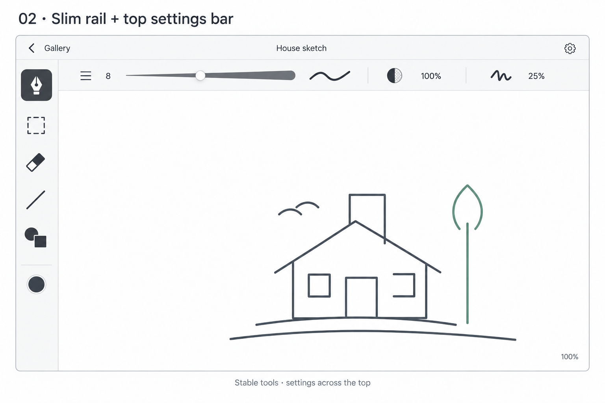

# Drawing screen v2 — selected left rail and top settings

Owner selected this screen for implementation as the next chat's first task on 2026-10-18 (decision234). This supersedes the circular-selector v1 proposal; no repeat approval of that retired proposal is needed. Implementation is the web UI prototype under [P05-D01](../../tasks/P05-D01.md), not an editing-engine or native-host implementation.

## Visual contract

Use the supplied image as the composition reference, not as a screenshot to paste into the app. Implement real semantic HTML controls in Vanilla Extract with existing shared theme resources. The image's presentation-board heading, outer frame and caption are not app chrome. Match the restrained monochrome layout, thin separators, spacing and optical icon alignment; use a consistent app-owned style in light/dark, without platform simulation or a tool wheel.

- Header: Gallery/Back, actual drawing name centered, settings entry at trailing edge.
- Left rail: Pen, Select, Eraser, Line, Shapes in that order, with a separated round color entry below. Selected Pen has a dark rounded square and contrasting icon. Icons need accessible localized names and visible focus.
- Contextual top row: width value8 and fully opaque tapered width slider, small stroke sample, opacity100%, smoothing25%, separated into legible groups. No redundant Stroke width heading. Width changes thickness only; opacity starts at100%.
- Main area: preserve the current sample image or blank New surface. The reference house is illustrative content, not a requirement to replace all six sample drawings. Zoom readout100% at bottom trailing edge; no invented canvas navigation engine.
- Use current semantic theme values; theme changes do not recolor saved/sample artwork. Do not reintroduce native-material requirements, different platform patterns or hidden selectors.

## UI behavior for this slice

Tools and property controls may demonstrate disposable local UI state and an isolated preview sample. They must not mutate gallery artwork, fabricate saved state or imply working erasing, shapes, stroke selection or smoothing. Maintain a clear non-editing preview indication. Reset draft tool/settings state on drawing entry; durable restoration is future shared-engine work. Render relevant controls for the active mode; do not fabricate Pen settings for Select.

Color is a visible entry in the rail. No wheel or Apply confirmation is required. Detailed picker anatomy, parameter ranges/presets and settings-sheet contents are not specified by this single image: the designer should resolve minimal UI-only behavior before coding, without turning it into a new feature/library. A visibly unavailable affordance is preferable to an inert enabled button or invented settings workflow. Optional preferences can be asked asynchronously; the selected screen implementation itself is already authorized. No automatic new tools, settings pages, brush libraries or persistence.

## Integration and accessibility

navigation.ts currently constructs Back/title/static artwork and traps Tab on Back. main.ts currently makes drawing Escape navigate Back. Replace these scoped behaviors: allow normal traversal through real controls; field/IME/dialog handling takes priority; Escape dismisses an open transient control or cancels an unfinished local adjustment, otherwise does nothing. Explicit Gallery/Back and browser history remain navigation. No global letter shortcuts or browser context-menu interception.

Controls belong to the drawing surface and its lifecycle. During entry/exit hidden controls are inert. On return remove temporary panels/listeners before travel. Do not let stale animation completion steal deliberately moved focus. Preserve whole-card and artwork animation endpoints, source hiding, gallery inertness, scroll/focus return, elevation/color continuity and interruption/reduced-motion handling. No new history entries for tool/settings changes.

Keep left rail plus top row at desktop widths. At narrow/short widths compact or scroll the contextual row, preserving Back/title access and every focused target; do not invent another mobile screen or cover artwork with unexpected layout jumps. Verify320px,390px, ordinary desktop, short landscape and enlarged text. Use localized en/uk names, numeric values with regional formatting, semantic buttons/ranges and clear selected states. Touch targets should be at least44CSSpx.

## Scope and provenance

Exact reference copied from the owner's attachment on 2026-10-18; hash and archived alternatives are in [archive index](archived-explorations.md). This is selected visual direction and web UI implementation authorization, not identified design/native approval, a tested design, or real engine acceptance. Prior v1 reviews are historical and do not certify v2. Designer guidance for this handoff is incorporated; next implementer must obtain runtime designer review and fresh independent review.
