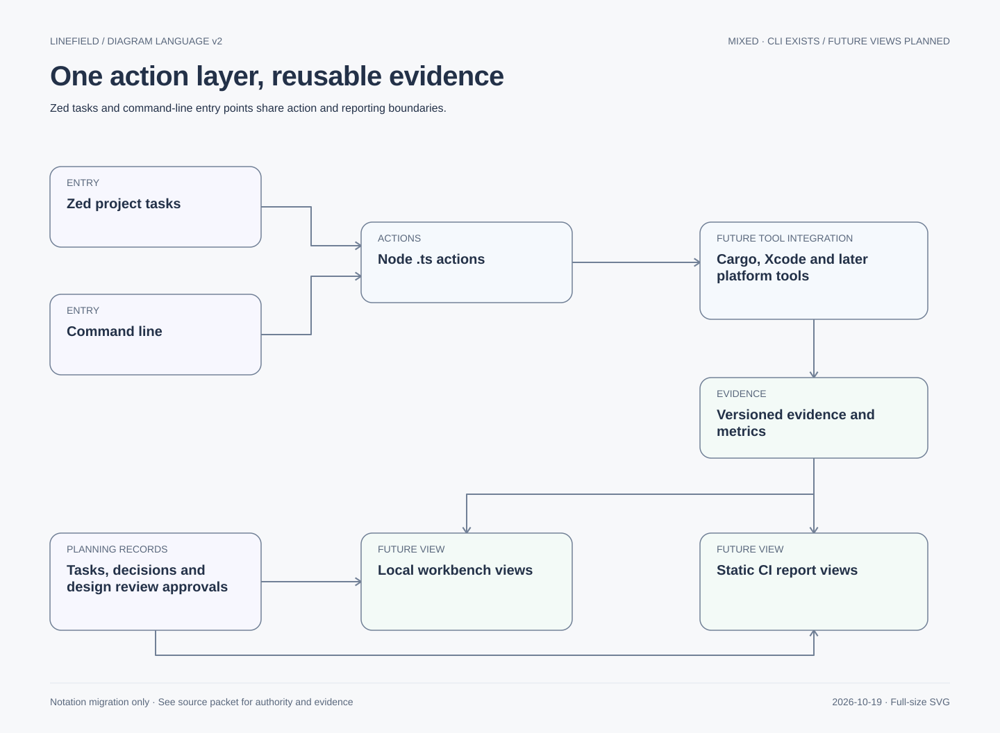

# Developer experience planned from day one

See the [Git strategy](workflow/git-strategy.md) for branch/review/evidence planning and
[visual architecture documentation](workflow/visual-architecture.md) for planner deliverables,
diagram formats, source/export ownership and the distinction between documentation and approval.

Owner selected **Zed tasks** as the integration on 2026-10-16. Do not implement a custom Zed
extension. Decision235 authorized the bounded local action/report CLI and five project task
launchers described in docs/developer-actions.md. CLI checks are verified; actual Zed runtime
focus/cancellation remains unrun. A rich GUI workbench remains a later reviewed UI scope.

## Shared foundation

Design tool inputs/outputs now so command line, Zed and future reports share the same truth:
versioned task/feature/contract/scenario metadata, dependency inventory, action descriptors,
execution records, artifacts and metric summaries. Source task/design decisions stay in their
reviewed repository records; results come from actual runners, never manually invented dashboard
statuses. Do not create duplicate mutable status databases in the editor and dashboard.

Native SVG, diagram style v2. The [migration index](diagrams/migration-v2.md) records source, status and text equivalent.

App runtime logging is specified in logging.md. Tool-job events use a compatible correlation
model but a distinct payload. Keep data schemas/pure selectors separate from process execution
and web presentation. Prefer straightforward JSON reports and native tool outputs, not a new
binary protocol or generic workflow engine. Concrete action/report interfaces are reviewed
in S01/S02 before implementation; metadata alone does not grant execution authority.

## Zed task integration

When scripts exist, .zed/tasks.json provides project-local labels for background checks,
builds, report generation, app launch and explicitly interactive native tests. Each entry
calls the same Node .ts entry point used from the command line; no duplicated Bash/PowerShell
business logic in task JSON. Zed may launch through its terminal shell; that is not a promise
of a shell-free host, and arguments/paths must be handled safely.

Background tasks should preserve editor focus. Separate foreground app/test tasks from them,
prevent conflicting native/GPU runs, and retain the owner's desktop-reservation requirement.
A click or task definition must not silently bypass that policy for an agent-initiated run.
Use native Xcode/Android Studio build/debug views where useful rather than reimplementing an
IDE. Links/task launches are capabilities to verify, not assumed programmatic button control.
[Zed task documentation](https://zed.dev/docs/tasks).

Zed's documented extension capabilities do not expose a general custom dashboard/webview
surface; do not base the GUI plan on one. The selected task approach is sufficient for
launching common project actions. A future browser workbench can be opened from a task.
[Zed extension capabilities](https://zed.dev/docs/extensions/developing-extensions).

## Later workbench and reusable reports

After separate owner/design review approval, a Vite/TypeScript browser workbench can show documentation,
tasks, dependency graph, feature/E2E coverage, build/run results, logs/metrics, design links and
Wasm preview. It consumes the shared report model. Reuse web presentation components/tokens
for static reports so local/CI views share terminology and appearance; no CI implementation
or publishing now. Plain HTML reports remain useful without a running action service.

Possible future layout, not source scaffolding required now:
- scripts/: Node action entry points and process adapters.
- quality/: reviewed metadata/evidence schemas and registry.
- .zed/tasks.json: thin task launchers, created only when real commands exist.
- apps/workbench/: later approved developer GUI, separate from apps/web drawing product.
- packages/dev-model/ and packages/dev-ui/: extract when shared model/views actually need them.

If a GUI later starts builds, use reviewed allowlisted action IDs/typed parameters, bounded
processes/output, explicit cwd, cancellation and capability checks. Do not accept arbitrary
shell commands from imported reports/Markdown or expose unauthenticated local command APIs.
Review loopback binding, origin/request protection and credential handling before adding a
local service. Published/static report views contain no execution capability. Render external
logs/docs as untrusted content; sanitize presentation and redact sensitive artifacts.

## Sequence and ownership

DX00 plans metadata/actions/design handoff alongside S00–S02. S01 implements shared script and
report foundations only after authorization. DX01 adds real Zed task launchers after those
commands exist. DX02 is a separately approved post-macOS workbench/report UI slice, not a
prerequisite for the editor. Later CI consumes existing reports without changing engine logic.

Lead owns scope; build_reliability owns process/report foundations; designer owns design review and
report UX; platform agents own tool adapters; reviewer checks authority, data safety and
honest evidence. No new permanent agent or Zed-extension development is required.

## On-demand agent architecture review

The project-local $linefield-review skill coordinates read-only milestone assessments and a consolidated
owner report; see [workflow](workflow/milestone-review.md). It is a chat invocation, not a Node/Zed
command, daemon or scheduled job. Executable build/test actions remain separately planned.
