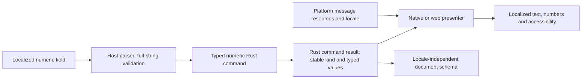

# Internationalization from day one

Status: owner requested architectural/design/test preparation on 2026-10-16. Documentation
only: no resource catalogs, translation libraries, localized builds or language support have
been implemented. Concrete contracts remain subject to S02 review.

Internationalization (i18n) makes the app work across languages, regions and writing systems.
Localization (l10n) supplies and verifies particular translations. Preparing i18n now does not
commit to shipping every language. The owner selected English (en) and Ukrainian (uk) for
the first launch on every implemented host. English remains source/authoring and complete fallback.
Use uk (language), not ua; uk-UA is a language-region tag when appropriate. Other translations
remain separately scoped. This does not force a regional format or keyboard. Concrete native
resource mappings and negotiation tests are reviewed in S00B/S02.

## Architecture and responsibility

Rust owns locale-independent commands, model values, validation, revisions and storage
semantics. Host presenters own translated wording, native labels, accessibility text and
locale-aware formatting/parsing. A Rust outcome such as invalid brush width carries a stable
typed error kind and typed bounds/units; the host renders the message. Do not return a finished
English sentence that the UI must parse. Native-only errors map to reviewed display categories;
private filenames/paths must not leak into normal logs.

Shared action/error IDs are never translated or derived from display labels. Typed bindings
preserve numeric values and error arguments, not formatted strings. A shared semantic message
inventory/glossary maps to each host's native resources. Platform wording may differ naturally;
do not duplicate editing policy or force every platform into one runtime localization library.
Review inventory/resource ownership and any generation pipeline before implementation; no
universal catalog compiler or localization service is introduced by this plan.

## Platform resource direction

| Host | Native resource/formatting approach to verify at implementation |
| --- | --- |
| macOS, iPhone/iPad, visionOS, tvOS, watchOS | Xcode String Catalogs (.xcstrings) and platform localization APIs; Foundation formatting; native per-app language behavior where supported |
| Android, Android TV/Google TV, Android XR, Wear OS; Android route on ChromeOS | Android string/plural resources, complete defaults, configuration-aware locale resources and native number/date formatting |
| Windows/WinUI | MRT Core resource management and .resw strings; native culture-aware formatting/layout |
| Linux/GTK | gettext-compatible catalogs and native GTK text/direction behavior; choose supported Rust bindings during the port |
| Browser and later workbench/report UI | External message resources plus reviewed message/plural formatter; Intl for numbers/dates/plural categories; HTML lang/dir and logical layout properties |

Apple documents String Catalog localization/plural variants. Android documents native resource
selection and the need for complete default resources. Windows documents MRT Core/.resw;
GLib documents its gettext integration. These are platform directions, not installed gates.
[Apple](https://developer.apple.com/documentation/xcode/localizing-and-varying-text-with-a-string-catalog),
[Android](https://developer.android.com/guide/topics/resources/localization),
[Windows](https://learn.microsoft.com/en-us/windows/apps/windows-app-sdk/mrtcore/localize-strings),
[GLib](https://gnome.pages.gitlab.gnome.org/gtk/glib/i18n.html).

JavaScript Intl provides internationalization primitives, not a complete translated-message
catalog or a general localized-number input parser. Vite bundles resources; Oxlint does not
supply translations or prove linguistic correctness. Select a message library only when the
web/tool slice is implemented, with size, plural, fallback and security review.
[ECMA-402](https://tc39.es/ecma402/).

## Language, region and fallback

Keep UI language, number/date region, time zone, keyboard layout and text direction distinct.
A user can use English UI with comma-decimal regional settings or a non-Latin keyboard.
Represent locale identifiers consistently (for example BCP 47 tags) at the host boundary;
do not infer nationality, drawing units or handedness from a language tag.

Decision 147: at launch follow OS/per-app preferences and supported host locale negotiation,
with a complete source-language fallback. Specify parent-locale/script matching and missing-key
behavior using the platform's actual resource rules; do not invent one string-splitting fallback
algorithm for every OS. For a missing resource use a safe default message and bounded diagnostic;
raw keys, empty labels and crashes are unacceptable. Shipping locales require reviewed coverage,
not permission to hide incomplete translations behind fallback.

Decision 147 selects language at launch; no custom language-picker or live-switch framework.
Later hosts must handle required native lifecycle/configuration events without data loss.
If live refresh is approved, it must not commit/cancel gestures unexpectedly, lose edits, reset
history or change document dirty state; host deactivation follows the existing cancellation
contract. Define handling of numeric edits when locale changes between focus and commit.
If a language change requires relaunch, use ordinary dirty-close/save/recovery guards; undo
history remains session-local. This requirement does not mandate live language switching.

## Messages and terminology

Externalize all app-owned user-visible text from the first implementation: menus/tooltips,
buttons, field labels/help/validation, loading/error/recovery prompts, file type descriptions,
accessibility labels/values/announcements and relevant package metadata. Keep OS-owned dialog
text under OS control. Internal event IDs and command identifiers are not UI strings.

Use complete messages with typed placeholders and translator context; never build translated
sentences by concatenating fragments or applying English word order. Use native plural/select
mechanisms where supported, or a reviewed host message formatter; never count == 1 logic.
Specify placeholder meaning, unit, allowed values and whether
an argument is literal user content. Validate argument names/types, plural forms and markup
escaping. Use vetted locale formatting instead of hand-rolled plural/date rules.

Maintain a glossary separating concepts such as stroke versus brush, Save versus Save As,
Cancel versus Discard, and Undo versus recovery. Map each term to the command/feature and
context rather than requiring the same literal word everywhere. A translation needs native-
language review; machine output may be a draft, never an automatic claim of supported language.

Do not upload private drawings/logs or credentials to translation services. No paid translation
platform is selected. Keep resource changes versioned; meaning changes invalidate prior review.
Do not suppress missing-key/placeholder failures by deleting strings or weakening applicability.

## Locale-safe numeric input and durable data

Display brush width, scale percentages, recovery dates and counts using the effective locale.
Parse editable numbers with a reviewed host parser and consume the entire intended input.
Reject ambiguous/invalid grouping, junk suffixes, overflow and non-finite values; do not replace
all commas with periods or use a permissive prefix parser. For example, a comma-decimal locale
may accept 1,5 as numeric 1.5; 1,234 cannot be interpreted by a universal heuristic. Test localized
digits/signs/separators and paste separately from a numeric keyboard's output.

Convert presentation units to the reviewed canonical values, then send a typed Rust command;
Rust remains responsible for domain range/finite validation. Parsing failure leaves the field
editable and does not mutate the document. Formatting precision must not silently round an
unchanged value into a different edit. Define percent scaling and rounding consistently.

Document fields, schema keys, IDs, numeric encodings, checksums and geometry remain locale-
independent. Save a fixture under multiple locales and compare its canonical semantic content;
allow only explicitly incidental metadata differences. Display dates locally but retain
unambiguous canonical timestamps. Do not translate user filenames or treat paths as locale-
encoded text. Use native storage APIs, safe UTF conversions and preserve valid user Unicode;
never globally normalize/case-fold filesystem paths to make fixtures match.

## Unicode, keyboard and canvas boundaries

Native text fields handle IME/marked-text composition, dead keys, grapheme-aware cursor/editing
and font fallback. Shortcuts must not intercept composition or consume typing in fields.
Keep semantic action IDs independent of localized shortcut captions. Review custom mnemonic
collisions and key-equivalent behavior across keyboard layouts; don't hardcode English letters
as the only way to reach a command. Standard platform shortcuts/responder behavior take priority.

Use native text measurement/truncation and bidi isolation where available for mixed-script
filenames or user text. Do not reverse strings, slice labels by bytes or silently alter content.
For web, set language/direction semantically and treat dynamic text as text rather than HTML.
[W3C direction guidance](https://www.w3.org/International/questions/qa-html-dir).

RTL affects appropriate UI reading/focus/layout direction. It must NOT mirror artwork, world
coordinates, stroke order, pan deltas, transform math or exported files. Audit icons individually:
back/forward may follow platform conventions; drawings, logos and geometric symbols do not
blindly flip. Dominant hand/tool placement is separate from reading direction; a new handedness
preference is not implied. Left/top geometry names are physical coordinates, not layout labels.

No text drawing tool is added. If later approved, editable canvas text requires a separate
Unicode shaping, bidi, font fallback/embedding/licensing and export design. Skia drawing alone
is not a complete text-editing/i18n implementation.

## Figma and rollout

S00A includes long pseudo-translated labels, LTR/RTL chrome, CJK/mixed-script examples, enlarged
text and numeric-locale examples. Demonstrate actual adaptive resizing with native control
mappings, preserving the identical drawing in LTR/RTL frames. Pseudotext is test material, not
approved translations. Platform-specific focus/AX/IME still requires runtime evidence.

Plan shared semantic keys/glossary early, implement native resources with the first macOS UI,
and validate pseudo-locales before translating many languages. Each later platform maps the
same meanings to native resources and repeats the locale matrix. TV/watch compact and remote
layouts, and XR surfaces, need their own readability/focus tests. Workbench/report presentation
uses the same separation between localized labels and stable evidence identifiers.

Track locale readiness independently for every platform: catalog completeness, translation
review, layout/AX verification, execution evidence and shipped status. A translated catalog or
Figma mockup is not proof of a supported locale. Both en and uk are required for launch on each
host; English remains source/fallback. No catalogs or translations are implemented. Concrete
resource mappings, glossary and translation-review evidence remain S00B/S02 deliverables.

## Two-language launch contract (owner update, 2026-10-16)

Both en and uk apply to macOS, iOS/iPadOS, visionOS, Windows, Linux, Android, ChromeOS,
web, watchOS, tvOS, Wear OS, Android TV/Google TV and Android XR as each host is implemented.
Viewer capability does not exempt localization. The macOS-first delivery order is unchanged.
Use native supported-language negotiation, including OS per-app preferences. Web follows the
browser's preferred languages (it cannot reliably read a separate OS language). No language
selector or persisted in-app language override. Resolve at launch; native configuration-triggered
recreation must preserve durable state. Do not implement a custom live-switch framework.
Do not infer Ukrainian from country UA alone or English from a keyboard layout.

Acceptance examples: en/en-US resolves English, uk/uk-UA resolves Ukrainian; when neither is
supported in the effective preference list, use English. Test ordered lists and actual platform
fallback rather than forcing one handmade locale parser. Missing Ukrainian translations fail
readiness even though runtime English fallback prevents a broken screen.
OS-owned dialogs may use OS-controlled wording; app-owned controls/AX require both languages.

No additional permanent i18n agent is recommended now. UX owns the terminology/context glossary
and coordinates proficient Ukrainian review; UI owns both language variants in adaptive Figma.
Platform engineers own catalogs, selection, plurals, numeric parsing and native E2E. Rust owns
locale-independent typed messages and domain semantics. Build reliability owns resource gates
and per-platform evidence; independent reviewer checks gaps. The lead names a locale reviewer
for each translation batch; machine output or untranslated English is not linguistic approval.
Linux/web/viewer work must have a named engineer even where no dedicated role exists.
Record translation and linguistic-review status separately from layout and runtime verification.

Source: [language codes](https://www.loc.gov/standards/iso639-2/php/code_list).

## DB4-B: shared default-name creation

Owner decision 159 makes localized default-name creation a narrow Rust responsibility. The host resolves the effective app language at launch (en/uk with English fallback) and passes it through a reviewed typed bootstrap contract. Rust owns complete default-name messages and formatting; no native formatting effect/reply. UX coordinates Ukrainian wording review. Use the durable allocation: first English name “Untitled”, then “Untitled 2”; numbers are never reused and gaps remain valid. Validate before publication and store the resulting name once. Later OS-language changes do not rename existing drawings.

All other UI labels, accessibility text, errors and region-aware field parsing remain native. No new localization library is selected. Test both languages, unsupported-language fallback, ordinal boundaries, failed creation, concurrent allocation and reopening after an OS-language change. Share naming fixtures across hosts; localized names are user-visible content, not locale-dependent IDs or schema encodings. Exact translation and runtime language DTO remain pre-code review items.
