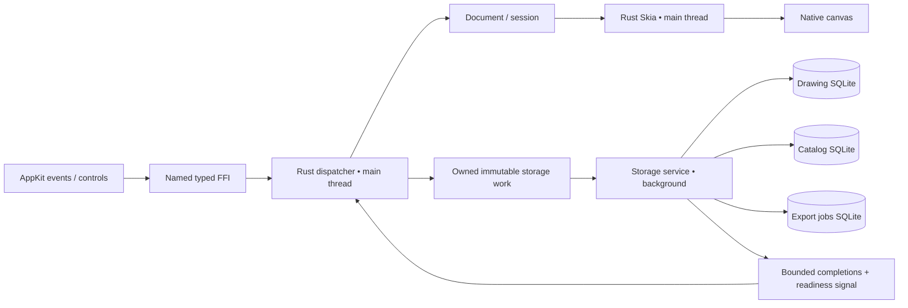

Current proposal: [S02 consolidated v2](S02-consolidated-v2.md). This older draft is historical where v2 differs; its pending-choice notes must not reopen decisions through 180. No implementation approval is implied.

Current direction: decisions 163–165 select multi-client incremental local editing and platform communication adapters, plus simple future cloud conflict warnings/conditional replacement. See ../architecture/incremental-collaboration.md and ../../tasks/S02M.md. Earlier exclusive-client alternatives/rename-only contracts below are historical or incomplete; exact mechanisms remain pending.

# S02 database and interfaces — proposal v1

Status: **table structure owner-approved; interfaces/coordination/recovery still pending; not implemented**. Updated 2026-10-16.
See [scoped approval](S02-table-structure-approval-2026-10-16.md); do not re-request approval of unchanged tables.
Lead integrates scoped database, Rust boundary and macOS coordination reviews. The repository
has no commit yet; the review manifest records exact document hashes.

This packet makes existing choices concrete. It does not authorize application code, migrations,
dependencies, Figma implementation, accounts, a resident service or another renderer.

## Read in this order

1. [Database sources and diagram evidence](../database/README.md): three separate databases,
   row-level sample storage, explicit tool settings and relationships.
2. [Typed interface](../interfaces/native-v1.md): concrete gallery-first declarations,
   copied output ownership, asynchronous effects and errors.
3. [Ownership and cross-process rename](../architecture/ownership-rename-v1.md):
   one editor owner, fences, conflict/unknown outcomes and transport feasibility.
4. [Recovery transitions](../architecture/storage-transitions-v1.md): durable checkpoints
   between files/databases, interruption and retry.
5. [Acceptance and threat delta](../../quality/S02-contract-review.md):
   planned tests, unresolved decisions and evidence status.

## Recommended division of responsibility

| Component | Owns | Does not own |
| --- | --- | --- |
| Native host | OS events, focus, menus, dialogs, localization, surface, access grants | Editing/save/Undo policy |
| Rust engine on macOS main thread | Typed commands, interactions, document/session, revisions | SQLite connections, native widgets, IPC |
| Rust services | Bounded storage jobs, lifecycle reconciliation, export jobs | Second mutable editor |
| Rust renderer on macOS main thread | Skia rendering and disposable caches | Durable document or authority |
| Typed native boundary | Checked handles, copied DTOs, named intent calls | Serialized command packets |
| Platform coordination adapter | Lock primitive, authenticated connection, advisory wakes | Permission to bypass shared commands |

Arrows crossing databases are application reconciliation, not cross-file foreign keys or
one atomic SQLite transaction. Future cloud operates on reviewed snapshots/change semantics,
not shared live WAL files. Future Wasm can use another storage adapter and readiness mechanism.

## Choice status after owner batch DB1–DB4

| ID | Recommendation | Alternative / consequence |
| --- | --- | --- |
| S02-D1 | **Selected DB1-A:** retain three databases; safe degraded recovery after catalog authority loss | Preserve uncertain files and block work requiring lost authority. No fourth control database; usable recovery information may be unavailable |
| S02-D2 | Stable per-drawing OS lifetime lock, retained through every storage transaction; generation fencing | SQLite transaction locks alone do not prevent two long-lived editors |
| S02-D3 | Authenticated typed NSXPC candidate, gated by a sandbox/signing/rendezvous feasibility probe | Shared-container SQLite mailbox is simpler but changes peer trust. A resident broker changes topology. Neither is silently authorized |
| S02-D4 | **Selected DB7-A:** caller-owned bounded DTO/text outputs | Exact declarations/handles/full ABI freeze remain pending; Rust-owned leases not selected |
| S02-D5 | **Selected DB8-A:** coalesced nonblocking readiness pipe observed on main queue | Exact lifetime/no-lost-wake/shutdown proof pending; other hosts use reviewed equivalents |
| S02-D6 | **Selected DB3-A:** multiple bounded durable rename receipts in the drawing transaction; strip local receipts on export/import | Numeric limits, expiration and generation-retention details pending. Missing receipt means unknown, not permission to re-execute |
| S02-D7 | **Selected DB2-A:** persistent local activity ordinal; real timestamps remain separate | Catalog draft adds allocator highwater and replaces timestamp ordering. Preserve existing activity triggers; exact durable allocation/retry/recovery sequence pending |
| S02-D8 | **Selected DB4-B:** Rust owns localized default-name creation, using host-resolved launch language | English/Ukrainian Rust messages need review alongside native resources. No native formatting round trip; ordinary UI localization stays native |

D2/D3 remain proposals. DB7-A/DB8-A select copied-output and macOS readiness directions; exact ABI and lifetime proof remain pending. The original table approval remains a historical baseline. DB2 authorizes the counter direction; the amended catalog fields are documented in the DB1–DB4 decision record. Concrete constraints/ABI/recovery transitions and all implementation remain pending.

## Before freezing this packet

The full canvas DTOs, native file-grant persistence, numeric capacities and timing budgets still
need a small follow-up contract revision. This packet specifies the gallery boundary first;
canvas/file-exchange names are staged, not advertised as a complete compilable ABI.

The NSXPC feasibility probe requires separate implementation authorization. Failure must return
to review; it does not authorize custom packets, mailbox fallback, broad entitlements or a daemon.
Figma remains a separate review gate for gallery/editor behavior and appearance.

## Delivery slices after approval and implementation authorization

1. S02A: disposable typed-header/Swift compile and sandbox coordination probes; record failures.
2. S02B: schema migrations, hostile-file validation and crash-injection fixture harness.
3. S02C: gallery command/effect conformance, fake storage races and bounded readiness/shutdown.
4. S02L: approved Figma gallery through real native controls, create/open/rename/delete E2E.
5. S04/S06: extend approved commands to canvas/autosave; S07E adds durable export.
6. Fresh review of actual code and exact-build evidence. Documentation review is not runtime proof.

Do not reopen settled DB1–DB4 policies. Next resolve D2/D3 ownership/coordination, including the ETag follow-up; then numeric capacities, complete DTOs, recovery details and final packet approval.
