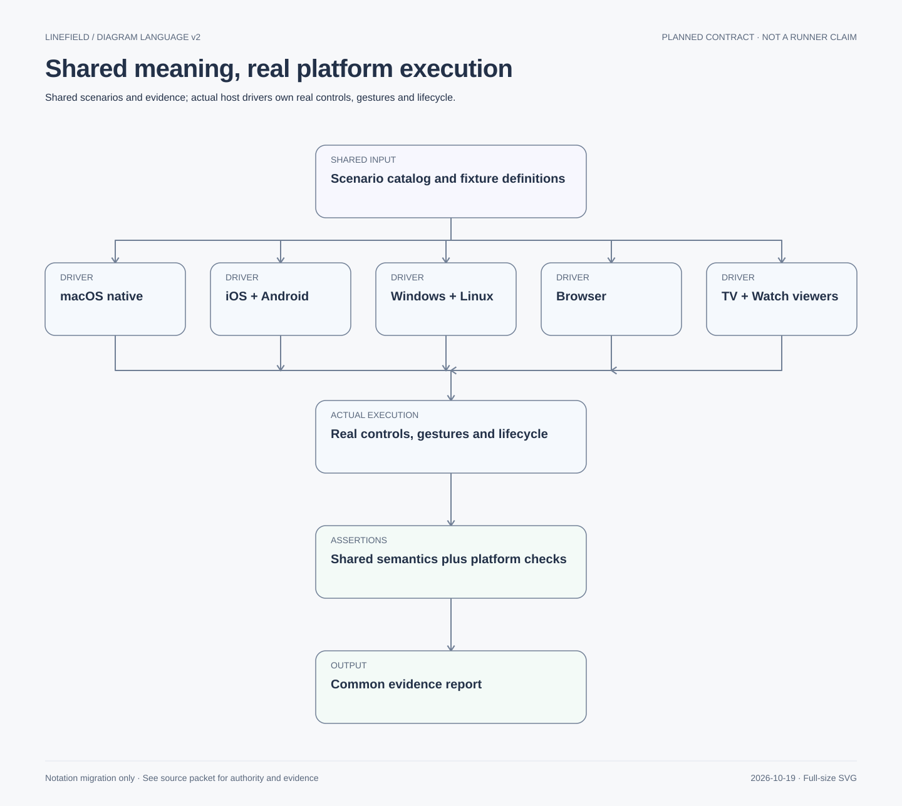

# Shared E2E scenarios with native execution

Status: documentation only. No runner, fixtures or tests are implemented. The owner requested
this approach in the plan; concrete tooling comes with authorized implementation.

Share behavioral scenarios, fixture semantics, acceptance IDs and evidence schema. Let each
platform execute them through its actual UI. Share meaning and expected outcomes rather than
coordinates, screenshots or a universal custom widget system.

Native SVG, diagram style v2. The [migration index](../diagrams/migration-v2.md) records source, status and text equivalent.

## Scenario contract

Each scenario defines ID/version, user goal, acceptance/invariant/contract IDs, capabilities,
fixture version/hash/seed, initial state, semantic steps, expected transitions, observable
results, tolerance policy, cleanup, timeout and permitted platform variants. Execution records
include exact build/revision, OS/device, driver/test IDs, fixture hash, result and artifacts.

Maintain separate dimensions: planned/automated coverage, execution outcome (not run/pass/
fail/skip), applicability (with reason), and evidence freshness. Preserve retry history;
a later pass must not hide a flaky first failure. A not-applicable viewer edit case must be
paired with a positive read-only enforcement case. A missing driver is missing coverage.

Start with this documented catalog, fixture definitions and equivalent native tests. Use
existing platform test frameworks with thin helpers. Do not build a general DSL interpreter,
remote automation protocol, new test service or universal runner before the second platform
shows which abstractions are useful. Generate only reviewed declarations/data where helpful.
Shared fixtures/results do not require every native test to be written in TypeScript.
Node .ts orchestrates runs/reports; native tests may remain Swift/Kotlin/C#/Rust as appropriate.

## Example shared scenario

EDIT-MOVE-ROUNDTRIP-001 (S06): open the two-stroke fixture through the real Open workflow,
choose Select, select the identified stroke, drag
it by a specified world-space delta, verify only that stroke moved, Undo, verify the original,
Redo, Save, close and reopen, verify the final editable document.

Earlier EDIT-MOVE-001 (S05) covers only selection/move/Undo/Redo. Its initial fixture may be
created through already-tested drawing interactions or explicitly reported isolated setup;
that setup is not Open/save coverage. DRAW-001 (S04) similarly ends after drawing/Undo/Redo.
S06 adds distinct persistence scenarios rather than recording partial scenarios as passes.

Example semantic driver vocabulary: openFixture, chooseTool, drawStroke, dragSelection,
invokeUndo, saveAndReopen, assertDocumentMatches. This is a small test-helper vocabulary,
not an approved application API or serialized command transport. Each helper has observable
pre/postconditions and failure diagnostics.

A desktop driver may invoke Undo using the native shortcut; a mobile driver uses its approved
control. Separately test both menu/control and shortcut paths where applicable. Derive canvas
coordinates from measured view bounds/viewport rather than fixed screen coordinates. Use
stable accessibility IDs for native controls; a custom canvas needs geometry-aware gestures.

## Real UI and trusted observations

E2E actions must operate real controls, gestures, focus and file workflows. Directly calling
the Rust dispatcher cannot stand in for an E2E action. Such tests remain valuable boundary or
integration tests but must be labeled accordingly. Routine setup may seed isolated files or
preferences, but it must not bypass the action the scenario claims to verify.

Combine accessibility/control assertions, visible canvas checks and saved-file semantic
checks. Use independent fixture expectations; an oracle that simply repeats the same buggy
implementation is insufficient. Canonical comparison includes stroke count/order/geometry,
styles/transforms and stable ID relationships. Normalize generated IDs/timestamps only when
the scenario declares them irrelevant, preserving identity relationships and event ordering.

A document comparison cannot prove that the screen rendered correctly; a screenshot cannot
prove editable content survived saving. Use both when necessary. Rendering comparisons use
reviewed tolerances and fixed color/scale settings; do not demand identical native UI pixels
across OSes. Native controls/fonts/antialiasing legitimately differ. Designer review covers
platform-specific visual behavior and accessibility.

Prefer condition-based waits on observable state over fixed sleeps. UI notifications, revision
changes or file outcomes may be observed through a reviewed read-only test interface where
needed; it must not mutate state, expose private data or ship as an enabled test backdoor.
Any fault injection is test-only, explicitly reported and separately tested for production
exclusion. An injected storage fault exercises UI handling under a controlled fault, not a
claim that the real OS spontaneously produced that fault.

Use disposable documents, per-run application data, fixed seeds and cleanup. Restore native
focus/launch state intentionally. Do not reset system permission databases or borrow another
application's trusted identity to make tests pass. Explicit foreground reservations remain
required. No screenshots/logs containing user drawings in routine evidence.

## Initial shared scenario catalog

All rows are planned, with zero automated/executed Linefield cases so far.

| ID | Goal | Shared acceptance | Applicable capability |
| --- | --- | --- | --- |
| DRAW-001 | Draw, undo and redo one stroke (S04) | SU-02–SU-04 | Editor |
| DRAW-ROUNDTRIP-001 | Draw, save, close and reopen an editable stroke (S06) | SU-03, SU-09 | Editor with file workflow |
| DRAW-CANCEL-001 | Cancel an active stroke without a durable edit | SU-03, SU-04 | Editor with approved cancel interaction |
| EDIT-MOVE-001 | Select/move one stroke, undo and redo (S05) | SU-05, SU-06 | Editor |
| EDIT-MOVE-ROUNDTRIP-001 | Open fixture, move/undo/redo, save and reopen (S06) | SU-05, SU-06, SU-09 | Editor with file workflow |
| EDIT-SCALE-001 | Uniform scale, cancel, commit, undo/redo | SU-05, SU-06 | Editor |
| EDIT-DELETE-001 | Delete selected stroke and undo | SU-05, SU-06 | Editor |
| NAV-001 | Pan/zoom keeps geometry and anchor stable | SU-08, SU-14 | Editor or viewer supporting navigation |
| FOCUS-001 | Editing fields preserves text shortcuts and editor intent routing | SU-02, SU-07 | Host with relevant native fields/shortcuts |
| FILE-ROUNDTRIP-001 | Autosave/flush, reopen library drawing, edit and persist correct document; native export/import-copy tested separately | SU-09, SU-10 | Editor with file workflow |
| FILE-REVISION-001 | Edit while save is pending; newer state remains dirty | SU-10 | Editor; synchronization observations documented |
| FILE-FAILURE-001 | Failed/cancelled Open or Save preserves current document | SU-09, SU-11 | File workflow; injected fault lane explicitly labeled |
| DIRTY-NAV-001 | New/Open/close/quit resolve pending/failed autosave; cancellation cannot revert already-persisted edits | SU-12 | Host-specific navigation variants |
| RECOVERY-001 | Recover committed content as unsaved copy, handle errors | SU-11, SU-12 | Recovery-capable editor |
| VIEWER-001 | Open/navigate content and reject editing capability | INV-10, CT-01, CT-08 | Read-only TV/Watch |
| EXPORT-001 | PNG export appearance/bounds without altering dirty state | SU-19 | Scope selected in decision 18; implementation/execution pending |

Each platform task adds concrete test IDs and variants before implementation. Pressure,
prediction and correction require core/replay plus actual supported device checks; synthetic
mouse gestures do not certify Pencil or Wacom behavior. Physical pen-to-screen timing remains
a separate camera measurement, not ordinary E2E timing.

## Platform-specific supplements

macOS: text-field shortcuts, menu validation, window deactivation/resize, Save flush and native import/export panels.
iOS/iPadOS: touch/Pencil cancellation, multitouch arbitration, suspension and file providers.
Android/ChromeOS: back navigation, recreation, multiwindow/resizing and storage permissions.
Windows: pointer capture, pen cancellation, window lifecycle and native file dialogs.
Linux: GTK focus/input lifecycle and portal/file access on the declared desktop.
Web: browser focus/shortcuts, permissions, offline storage/quota and tab lifecycle.
TV/Watch: remote/crown navigation, read-only enforcement, loading/offline errors; Watch phone
availability and later network fallback need their own approved service tests.
visionOS: approved input/focus/lifecycle on its actual supported presentation mode.

The catalog is not a promise that every scenario applies identically to every OS. Declare
native variants and capability differences rather than forcing desktop behavior onto mobile.

## Delivery and ownership

S01 prepares the registry/report schema and discovery rules when tooling is authorized.
S02 freezes contracts and scenario semantics/fixtures, with owner review where required.
S03 supplies core/boundary conformance; S04–S06 supply macOS real UI tests alongside features.
S07 checks failure/performance/evidence correctness; S08 requires complete applicable coverage.
P01 introduces the second native driver and refines shared helpers from actual duplication;
P02–P12 reuse scenarios and add native supplements. No premature universal framework.

Implementers own feature scenarios and tests; build_reliability owns runner/evidence discovery;
designer owns native interaction/visual expectations; rust_engine owns semantic fixtures and
conformance; reviewer rejects mislabeled E2E, missing coverage and weakened expectations.

Adaptive design evidence: docs/design/foundations.md defines design review resizing checks, not runtime E2E. Platform drivers still test actual resizing/focus/accessibility. P10 adds Android TV/Google TV remote navigation and VIEWER-001; P11 adds approved Android XR 2D input/focus/surface lifecycle tests.

## Locale variants

Apply [internationalization scenarios](internationalization.md) to shared flows with explicit locale applicability. Use stable IDs, assert translated UI/AX text separately, exercise native number fields/IME and confirm RTL never mirrors artwork. Source/pseudolocale readiness differs from shipped translation support. S04–S05 cover implemented interactions; file roundtrips/recovery follow S06, avoiding premature dependencies.

## Application navigation and motion

Use [route/motion scenarios](navigation-motion.md) for browser history/native Back, direct
entry, dirty guards, stale loads, restoration/focus and interrupted/reduced motion. NAV-001
continues to mean canvas pan/zoom. Actual history/gesture execution is separate from injected
command tests; animation-disabled functional runs do not replace real motion evidence.

Wear OS P12 adds actual watch navigation/rotary/accessibility, lifecycle/offline and battery/resource cases. VIEWER-001 applies if the recommended viewer scope is approved; emulator evidence does not certify physical-watch behavior.

## Gallery-first scenarios (decision 7)

S02L owns LIBRARY-CREATE-001, LIBRARY-RENAME-001, LIBRARY-OPEN-001, LIBRARY-DELETE-001,
LIBRARY-FAILURE-001 and LIBRARY-NAV-001 for SU-21; task S02L defines outcomes and dependencies.
Keep native create/rename/restart/navigation evidence separate from later drawing/autosave tests.
Synthetic thumbnails/temporary editor destination cannot certify actual artwork rendering.
Decision 212 supersedes ordinary confirmed deletion: test recoverable removal, same-slot Undo, multiple pending items, failed/cancelled navigation, resize/background persistence and exact restoration. Production requires reviewed staging/finalization and crash recovery contracts; prototype evidence is not storage evidence. Native-file roundtrip scenarios must use the reviewed
library import/export-copy semantics rather than assume editing an external source in place.

FILE-IMPORT-COPY-001 (S06, SU-09/11, CT-01/05) verifies an external Linefield document becomes
an independent library item, source bytes remain unchanged after editing/deleting that item,
and repeated embedded IDs cannot silently replace existing content. Test cancellation, invalid
input, interrupted staging and storage failures separately. Native picker execution is E2E;
injected adapter outcomes are boundary tests. Identity/cleanup contracts require S02 review.

HISTORY-SESSION-001 (S06, SU-04/06/10/12): autosave retains active Undo/Redo; Undo/Redo changes
persist. Successful gallery return/session close and reopen retain artwork but clear both stacks.
Cancelled/failed navigation, native dialogs and temporary focus changes preserve history. Test
relaunch separately; planned history checks are not evidence of implemented behavior.

AUTOSAVE-BATCH-001 (S06): native editing/exit scenarios verify bounded-batching persistence and
visible pending/failure behavior. Deterministic deadline/coalescing/race checks belong to core/
service tests, not native E2E labels. Verify restart content against durable revisions, preserve
individual Undo operations and exclude predictions/unfinished gestures. See S02/S06 and decision 11.

AUTOSAVE-FAILURE-BOUNDS-001 (S06): local write failure leaves a persistent visible indication,
permits editing within limits, then pauses mutation safely. Accepted content remains; inspection/
retry controls work; failed/cancelled exit retains the session. Verify recovery/resume and stale
completion rejection. Memory/queue thresholds use separate deterministic instrumentation; native
E2E covers actual input/control gating. Never label injected service calls alone native E2E.

## All-tool interruption contract (decision 73)

DRAW-CANCEL-001/FOCUS-001 must exercise actual drawing-window deactivation for each implemented
interactive tool. Begin, produce visible uncommitted work, deactivate, then verify rollback,
preview cleanup, preserved prior content/history and no partial persisted result. Reactivate;
late events cannot commit the cancelled gesture and a fresh interaction must succeed. Cover
repeated/stale cancellation in shared deterministic tests separately. Future tool tasks inherit
these cases; unimplemented tools are planned coverage, never passes. Native text editing/IME
retains its own focus semantics. Request a foreground session for native automation.

## History availability during interactions (decision 74)

For each implemented tool, attempt document Undo/Redo during visible unfinished work. Verify
unchanged preview/content/history, no forced completion/cancellation or delayed replay, and native
action availability. End/cancel, verify actual history availability, then issue a fresh request.
Cover native text Undo/IME priority separately. Use shared boundary fixtures for races/stale
callbacks and actual native UI tests for control/shortcut behavior; future tools inherit cases.

## Tool switching during interactions (decision 75)

For every implemented interactive tool, attempt a switch while work is unfinished. Verify disabled
native actions and shared rejection with unchanged preview/settings/history/last-active metadata.
Neither automatic cancellation nor a deferred switch is allowed. After end/cancel, verify an
explicit new request switches and restores the intended tool's settings. Shared tests cover
ordering/stale callbacks; native controls/menu/shortcut and field-priority behavior need UI E2E.

## Explicit Escape cancellation (decision 76)

Exercise Escape in each implemented tool's active interaction, idle with selection and idle
without selection. Verify rollback/no history, clear selection or no-op respectively, retaining
current tool. Test repeated/held/stale input and fresh interaction afterward in shared fixtures.
Real native keyboard/dialog/field/IME cases must prove priority and no double dispatch. Future
tools inherit the same canvas cancel contract; no unimplemented platform is marked covered.

## Canvas navigation during editing (decision 77)

Initial macOS NAV-001 covers scroll/pinch/Space-drag/menu/shortcut origins during pen/move/scale:
viewport and active edit stay intact, navigation is not queued, and end/cancel causes no delayed
jump. Verify idle navigation with/without selection and navigation's own updates. Shared fixtures
cover blocked stream/momentum/order boundaries; native mouse/trackpad/keyboard evidence is separate.
Do not label other-platform simultaneous-input behavior implemented from this macOS choice.

## Canvas mapping changes during interactions (decision 78)

DRAW-CANCEL-001/NAV-001: begin pen/move/scale, trigger a canvas mapping change through window
resize or an applicable display/backing-scale transition, verify shared cancellation before new
mapping input is accepted. Completed artwork/history remain; no partial commit, previews or
stale-event revival. Fresh input works with the new mapping. Cover repeated callbacks and a
window move that does not change mapping. Injected ordering tests and native UI evidence are
separate; identify device/display setup and record unavailable transition coverage explicitly.

## Logical canvas size and display density (decision 79)

NAV-001/DRAW-001: verify known artwork spans the expected logical view-point distance at 100%
and another zoom. Shared fixtures test forward/inverse conversion and backing scales at reviewed
tolerances; native E2E verifies actual host view/surface mapping. Moving across applicable displays
must preserve stored geometry and revision. Follow decision 78 for active interaction cancellation.
PNG dimensions must remain independent of display density/zoom. Synthetic scale fixtures do not
substitute for real display-transition evidence; report unsupported hardware coverage explicitly.

## Fixed PNG raster scale (decision 80)

EXPORT-001: for nonempty fixtures, assert independently decoded PNG dimensions from all-artwork
bounds plus the reviewed margin at one pixel per logical canvas unit. Include fractional bounds,
scaled stroke widths, distant marks, multiple viewport zooms and backing scales. Check oversized
output rejection without silent resampling or document/history changes. Empty output remains
exactly 1920 by 1080. Concrete margin/rounding fixtures follow S02 approval; native export flow
and injected resource/failure cases remain separate evidence lanes.

## Fixed PNG border (decision 81)

EXPORT-001: verify a 16-logical-unit margin on each side of nonempty full visible artwork bounds,
including transformed stroke widths/caps/joins. At the selected scale this is nominally 16 pixels;
integer raster expectations follow S02's reviewed rounding. Cover fractional/negative positions,
point strokes and all four borders; pan/zoom/backing scale cannot alter framing. Empty output is
still exactly 1920 by 1080, without added margin. Thumbnail margins are a separate contract.

## Automatic catalog recovery (decision 82)

LIBRARY-FAILURE-001: use disposable libraries with missing/corrupt catalogs and mixed valid/invalid
managed drawings. Verify valid items return, recovery is communicated, damaged catalog/unvalidated
files remain preserved and local-preference loss is handled honestly. Storage tests cover interrupted
rebuild/retry, allocation/access failures, newer schemas, duplicate IDs and lifecycle remnants.
Native E2E verifies gallery/recovery presentation; injected failures alone are not UI acceptance.
No real user data is damaged for tests. Do not mark unrecoverable drawings or unavailable settings
as recovered; source paths/names must not leak into diagnostics.

## Unavailable drawings in a healthy library (decision 83)

LIBRARY-OPEN-001/LIBRARY-FAILURE-001 retain an entry when its file cannot be opened. Native E2E
verifies accessible unavailable status, explanation, explicit retry and successful restoration.
Use disposable fixtures for missing, access-denied, invalid and unsupported-version cases; verify
no blank replacement, no hidden/deleted entry and no loss of the prior accepted session/history.
Boundary tests cover identity mismatch, stale completion and deletion/retry races. Treat cached
metadata/thumbnail as last-known rather than proof of validity. Recovery cannot claim unavailable
files as repaired merely because the entry remains visible.

## Duplicate document identity during recovery (decision 84)

LIBRARY-FAILURE-001 preserves both same-ID file candidates and reports an unresolved conflict,
while unrelated valid drawings recover. Shared tests vary content equality, timestamps, scan order
and retry/interruption; assert no source changes, automatic new IDs, merge or winner selection.
Same-name/different-ID controls remain valid. Native E2E verifies honest conflict presentation and
access to unrelated recovered items; do not claim resolution tooling exists or has been approved.

## Historical confirmed-delete recovery and decision 212 amendment

Decision 212: the initial Delete tap is recoverable staging, never the irreversible intent below. Do not implement or test the old confirmed-delete flow as the current UI. A future reviewed finalization contract must distinguish staged, restored and finalized operations; crash/quit behavior, owner fencing and export consent remain review requirements.

LIBRARY-DELETE-001/LIBRARY-FAILURE-001: interrupt before durable intent and at each subsequent
reviewed deletion phase; restart repeatedly. Destructive continuation requires the exact valid
confirmed intent. Assert no collateral deletion or stale-save/rebuild resurrection and correct
pending/failure/completed states. Native confirmation/recovery UI evidence remains separate from
injected storage/crash cases. Use disposable fixtures; missing files alone never authorize deletion.

## Batch 1 acceptance additions (decisions 86-94)

Storage conformance: compare incremental saves to full reference semantics through draw/transform/
delete/Undo/Redo and reopen. Verify sample cascade enforcement, rollback, bounded transient retry,
manual Retry, nontransient errors and no stale revision acceptance. Bounds caches must agree cold,
warm, evicted and reconstructed, without stored derived bounds. Same valid fixture under different
host caps must produce honest capacity rejection without file mutation/truncation.

Gallery native E2E: slow/reorder/fail page and thumbnail delivery in disposable large libraries.
Scroll/revisit and verify demand-driven bounded loading, reserved geometry, unchanged anchors and
stable focus/AX IDs. Compare placeholder/loaded/error positions within reviewed host tolerances;
resizing or text scaling is a separate intentional layout change. Cached preview must not show a
newer unsaved revision; reject stale/deleted results. Repeat on each implemented host; synthetic
browser metrics alone cannot establish native-platform layout stability.

Input baseline: DRAW-001 uses actual samples only in the first preview. Future prediction fixtures
remain planned contract work, not a claim of native prediction implementation or execution.

## Batch 2 acceptance additions (decisions 95-102)

Build/boundary conformance verifies matching static host/Rust builds, generated declarations,
coherent small projections and capacity/stale-handle failures. Collection gap fixtures verify
bounded resync, atomic handoff and preserved native identity/scroll/loading geometry. Native effect
fixtures cover repeated reads/acks, failed acceptance, insufficient capacity, completion and no
panel replay; UI tests verify actual single presentation and focus behavior separately.

Scheduling tests inject preview backlog, save priority and completion bursts, checking fairness,
atomicity, preserved order and bounded queues. Measure responsiveness on exact builds; no runtime
claim from a mocked budget. Export fixtures cover bounded FIFO admission, count/bytes, immutable
revision/destination intent, cancellation and same-target publication. Native queue/status/panel
acceptance requires approved design review; quit assertions wait for Q9. All cases are still planned.

## Decisions 103-109 acceptance additions

EXPORT-001 covers normal Quit with active/queued jobs, status/cancel path, failures, publication
races and independent pending-save handling. Boundary failure injection and real native exit/
focus/panel cases remain distinct. Verify padded-origin/ceil-dimension PNG sizing with fractional,
translated and transformed geometry, no world-grid snapping and exact empty-output exception.

DRAW-CANCEL-001 exercises malformed current actual batches, atomic rejection/shared cancellation,
unchanged prior history/artwork, stale-session isolation and fresh next begin. DRAW-001 verifies
10%-to-100% linear pressure, pressure absence and contact rules with both fixtures and actual pen
input. Native documents preserve normalized floating-point sRGB values under the reviewed numeric
contract, separate from output quantization. EDIT-MOVE/SCALE cases preserve overlap order;
selection hits full visible stroke shape with zero interior distance and topmost ties. Validate
cold/warm cache, zoom/display scale, Undo/Redo and reopen/export parity. Tests remain planned.

## Selected visual and evidence scope (decisions 110-114)

Every suitable native E2E flow step receives a screenshot baseline/checkpoint. Report unsuitable
steps and reasons; a missing baseline is not a visual pass. Use observable capture readiness and
reviewed per-host/OS/font/scale/locale tolerances without masking meaningful loading/layout defects.
Keep functional/AX/persistence assertions and real motion tests. Ordinary runs collect failure
screenshots/logs plus required acceptance images; video is targeted to gesture/motion diagnosis.

Use synthetic/disposable content and exact build/fixture/test metadata. No unrelated desktop or
private drawing capture. Preserve failed/retried outcomes. Eligible old successful payloads may be
pruned under reviewed limits, but unresolved failures and pinned review evidence remain protected.
Reports retain required provenance and explicitly mark unavailable raw payloads. Protected-data
capacity exhaustion pauses further large capture for cleanup. App logs/recovery files are separate.
Short seeded generated/fuzz checks and longer milestone campaigns are background conformance lanes,
not native E2E or proof of visual/physical latency; required reservations remain unchanged.

## Batch 5 lifecycle and output evidence (decisions 116-120)

Use isolated managed-library fixtures with actual independent application processes. Verify
different-drawing ownership, catalog coherence, contested writes, process death and stale results.
Do not infer process safety from single-owner unit tests. Native open/focus/recovery UI needs a
reserved foreground session and reviewed design; no multi-window affordance is assumed approved.

Storage cases cover bounded proactive upgrade, owner coordination, validated backups, interruption
and failure isolation. Restore-as-copy preserves damaged original, assigns fresh IDs and warns
about potential missing newer edits. Changing-source import must reproduce one coherent captured
revision without source mutation. EXPORT-001 independently checks 8-bit PNG channels/metadata and
unchanged floating-point native color/history/save state. Concrete mechanisms and fixtures remain
planned; no runtime verification is established by policy approval.

## Batch 6 durable export acceptance (decisions 121-126)

EXPORT-001: accept Export, delay/cancel destination selection, edit/navigate and verify the captured
revision remains fixed. Check editor-independent status/cancel through approved native controls.
Queue multiple same-destination jobs, confirm valid sequential replacement, changed targets and
canceled/failed predecessors. Continue unrelated safe jobs while retaining the failed outcome.

Use disposable storage and actual processes for crash points around source persistence, intent,
publication and completion acknowledgement; injected unit failures are a separate lane. Preserve
already-published files and refuse blind replay of ambiguous writes. Test missing access, job
corruption/version, resource exhaustion, stale workers and native recovery/consent states once
approved. Three-job cap includes active/waiting/reserved work and separate byte/work admission;
multiple-process scope remains unanswered. No runtime coverage exists yet.

## Batch 7 ownership acceptance additions (decisions 127-131)

Extend CT-01/03/05 lifecycle and library scenarios: contested explicit Open activates the correct
existing owner, with safe in-use fallback for unsupported/denied activation, stale identity and
owner exit. Verify no second writer, unrelated focus switch or notification-triggered activation.
Exercise real separate processes for busy-upgrade deferral/unrelated progress and busy-delete
rejection followed by a fresh confirmed request after release. Inject ownership loss at interaction,
queued-write and transaction boundaries: unfinished work cancels, completed RAM work survives where
possible, new mutations pause and fenced stale workers cannot overwrite. Preserve honest limits
for already committed writes. Test duplicate/missed/reordered advisory signals, lifecycle catch-up,
coherent catalog validation and bounded coalescing. Runtime process tests and actual native focus/
error UI evidence are distinct; neither is implemented or passed by this documentation update.

## Batch 8 durable-export acceptance (decisions 132-138)

Extend CT-03/05/06 export/recovery/library scenarios: separate job DB survives catalog rebuild;
pre-panel snapshot remains immutable, destination cancellation releases RAM reservations, persistence
starts after confirmation, and restart recovery applies only past the reviewed durable boundary.
Verify auto-resume of safe work and explicit pauses for ambiguous publication, lost access or changed
targets; renewed confirmation must apply to the actual publication target. Test safe terminal snapshot
cleanup, shared references, interrupted cleanup and honest new-request retry after source release.

Test deletion confirmation cancellation preserves drawing/jobs; accepted cancellation coordinates
with running exports, durable deletion and crash recovery without deleting completed external files.
Use real concurrent processes for independent three-job caps plus shared capacity rejection, stable
FIFO under claims, failed-process takeover and no double execution or durable-job loss on relaunch.
Define matching native status/confirmation E2E and structured redacted diagnostic expectations.
These are planned cases, not implemented/discovered test IDs or passing evidence.

## Maintenance and metadata acceptance (decisions 139-143)

Add real process/storage scenarios for one maintenance owner, safe handoff on verified release,
interruption recovery and no takeover merely on suspension. Race simultaneous unnamed creation:
shared numbering persists across ordinary restart/rename/delete, without asserting gap-free results.
Verify import top placement, honest retained timestamps, subsequent edits and stable paged focus.

Exercise cross-process rename through the actual owner's shared dispatcher, durable success and
catalog reconciliation; cover rejection during applicable active interactions, owner exit, conflicting
requests, duplicate/late acknowledgements and unknown outcomes without blind retry or second writer.
Native E2E separately checks pending/failure/success UI and IME/native shortcut behavior. Shared
name cases include edge/internal whitespace, blank rejection, international text and preserved
legitimate direction marks; imported names are not incidentally rewritten. No executed passes claimed.

## Sandbox/local storage acceptance (decisions 144-145)

Plan actual sandboxed macOS evidence for local library persistence, user-selected import/export,
revoked/expired destination access, restart recovery and same-library multiple processes including
coordinated rename. No broad entitlement or unsandboxed execution may substitute for this acceptance.
Test that denied file access yields a truthful recoverable failure, not replacement of user data.
Offline/local save behavior remains independent of any future cloud state. Future sync/encryption
cases require their reviewed scope; Q60 now selects no application-level encryption for preview (decision 146).

## S00F input acceptance proposal

[INPUT-01–12](../input/contract-and-tests.md) supplement existing scenarios; all are planned/unexecuted.
INPUT-01/02/06 map to SU-02/07/20 and FOCUS-001; INPUT-03/04/07/11 to SU-03/04 and DRAW-CANCEL-001;
INPUT-05/08 to SU-08/12 and NAV-001/DIRTY-NAV-001; INPUT-09 to VIEWER-001/INV-10; INPUT-10/12 to
SU-17/20 and design/AX review. Accessible authoring completion is a separate gap, not inferred from
accessible menus. New binding/touch defaults remain owner proposals; use approved profiles in real
native tests. Historical Save As examples do not override selected autosave/import/export-copy semantics.

## Multi-client and future sync coverage

S02M adds MC-01–MC-08 and future SYNC-01–SYNC-07 in ../architecture/incremental-collaboration.md. Share semantic assertions but execute real two-client native/browser UI on applicable hosts. Cover independent strokes, same-object rules, per-client Undo/cancellation, duplicates/resync, crash/no split authority, lifecycle/caps and viewer/peer rejection. Future cloud fixtures cover changed versions during confirmation and uncertain publication. None implemented or executed.
