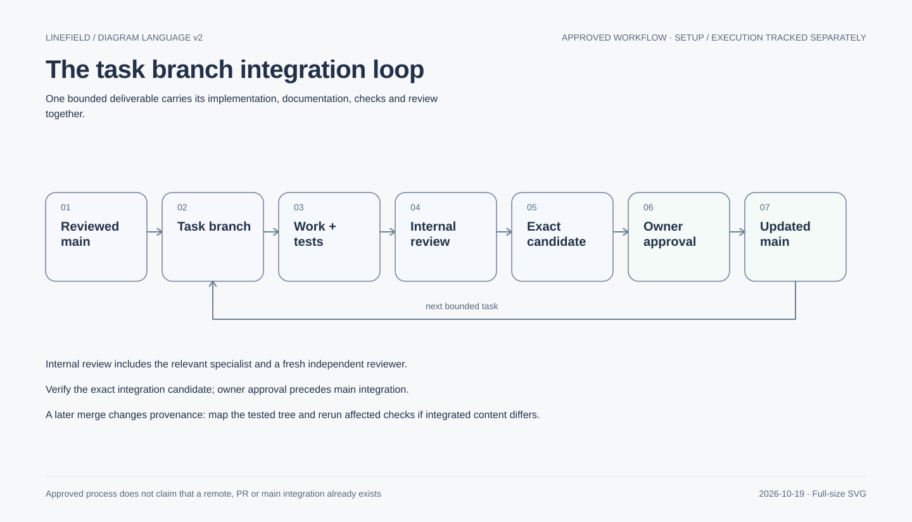

# Linefield Git strategy

Prepared 2026-10-19 at the owner's request. This is the recommended workflow and transition
plan; it does not create branches, commits, remotes, protections, CI or releases. Main merges
and publication retain owner approval. Local commits for already-authorized work remain permitted.

## Recommended model

The owner has proposed a [task → PR → fresh-chat lifecycle](task-pr-chat-plan.md).
Under that plan, each executable leaf task owns exactly one branch and one PR; parent milestones
do not get implementation branches. The detailed transition and task restructuring remain a plan.

Use a single integration branch, `main`, with short-lived `codex/<task>-<purpose>` branches.
Keep the monorepo together: shared contracts, Rust, hosts, resources, tests and documentation
evolve in one reviewable change. Avoid permanent web/macOS/engine branches or a separate develop
branch: they would delay integration and split contract truth while this small project evolves.
One branch represents one bounded deliverable, not five hours of unrelated work.

Examples: `codex/p05-library-admission`, `codex/s02-create-contract`,
`codex/dx-documentation-checks`. Platform work can have separate task branches once independently
authorized, but shared contract changes need one owner and an agreed base before parallel work.

Native SVG, diagram style v2. The [migration index](../diagrams/migration-v2.md) records source, status and text equivalent.

## Current checkout: transition before ordinary branching

Observed2026-10-19: only local branch `codex/project-foundation`, HEAD
`fbcc30ca115d630d6c9e688b1525d3ee1dcc89d7`, two commits. No local main or remote-tracking refs
were present; no Git remote is configured. There were255 status entries before this documentation
addition; an untracked directory entry can contain many files. No remote protection is configured
by this plan.
Do not treat this checkout as a clean main or silently rename it.

1. Inventory tracked changes, untracked files and relevant ignored evidence; map each to task,
   owner and approval/evidence. Keep the current checkout intact. Git diff alone omits untracked
   files, and a new branch alone does not save any uncommitted bytes.
2. Preserve an explicit local recovery snapshot of eligible work before reorganizing it: reviewed
   checkpoint commits on the current task branch, or a verified separate local copy if staging
   cannot safely isolate intertwined changes. Include needed untracked files deliberately.
   Never use blanket `git add .`, reset/clean, stash-as-backup or checkout replacement here.
3. Review contents before staging: no credentials, personal drawings, private research captures,
   browser profiles, package caches or downloaded vendor bundles. Preserve necessary local-only
   data separately; exclusion from a commit is not authorization to delete it. Do not force-add
   ignored artifacts wholesale. Record exclusions and recovery location without secret contents.
4. Group the delivered work into coherent, verified commits where dependencies permit: web UI and
   regression tests; shared resources/tooling; storage experiments and selected evidence; architecture
   proposals. An explicitly labeled preservation checkpoint is acceptable when artificial splitting
   would risk loss or misleading independent-pass claims. Do not rewrite earlier accepted history.
5. Present the proposed initial main snapshot and validation to the owner. Only after approved
   integration establish main at that identified commit. If a remote is later selected, agree its
   destination/access and publication separately. This document does not authorize an upload.

The working tree remains unchanged by this plan. This transition is outstanding work, not completed
backup or evidence that all current files are safe to publish.

## Daily change and agent workflow

- Start from the latest reviewed integration state. Record base SHA, task, owned paths, approval
  scope, contract/invariant/scenario IDs and stopping condition. Inspect status before switching.
- Prefer an isolated worktree for implementation writers, as AGENTS requires. A worktree starts
  from committed state and does not inherit the current dirty checkout. First preserve and commit
  the required base; never let an agent unknowingly work from stale contracts.
- Respect at most three concurrent subagents, two implementation writers and one feature in flight.
  Give shared contract/schema files one owner. Read-only reviews need no separate writer checkout.
- Commit a coherent behavior plus its tests, relevant documentation and evidence references.
  Titles explain the outcome, e.g. `fix(web): preserve keyboard focus in settings` or
  `docs(storage): record recovery adoption blocker`. Task IDs belong in the body when useful.
  Conventional prefixes are a readability convention, not a new commit-lint dependency.
- Keep commits small enough to review/revert; do not split tests away from the behavior they prove.
  Separate unrelated dependency upgrades, formatting churn and generated-resource changes.
- Rebase only private, unshared task history when safe. Once other work depends on a branch,
  coordinate integration without rewriting it. Never force-push shared history. Resolve conflicts
  by preserving both intentions and repeating affected tests, not blanket ours/theirs selection.

## Integration and verification

Use a local review packet now; use a draft PR once remote publication is authorized. Include
problem/result, scope and exclusions, approval references, contracts/diagrams, exact evidence,
risks and rollback. A PR is a review mechanism, not automatic main-merge permission.

Prefer squash integration for a single bounded task with fixup/checkpoint commits. Preserve a
reviewed multi-commit series when individual steps are useful and coherent. Decide before final
verification. Verify the actual integration tree after conflict resolution; a squash changes the
commit identity even when its tree matches. Never relabel pre-integration results as a new run.

Require applicable checks, fresh independent review and designer review for UI changes. Record
base/commit and tree or source hashes, tool/browser versions, test IDs, results and gaps. For dirty
builds retain exact hashes as already practiced. Reports should identify their tested input without
requiring a self-referential commit hash. Add the final integration reference as provenance; retain
the original report. Re-run affected checks whenever the tested source changes.

Current local commands exist: `pnpm check`, focused package checks and browser tests. They are
not remote required checks until CI actually runs them. Future hosting protection should prevent
direct main pushes/force-pushes and require review plus applicable checks; configuration is a
separate action. Do not add branch rules that depend on nonexistent CI jobs.

## Recovery, artifacts and later releases

Revert a bad integrated code change with a new commit; never reset published main. A code revert
does not undo an on-disk schema migration or recover overwritten data: those need their reviewed
compatibility/recovery plan. Keep task branches/worktrees until integration and evidence are verified;
archive only when needed untracked/ignored data is separately preserved.

Commit small curated manifests, summaries, fixtures and review-pinned images where appropriate.
Keep regenerable downloads, bulk captures and profiles out of ordinary history. Record hashes,
tool versions and retrieval/retention instructions for external artifacts; do not claim a hash
alone preserves the artifact. Propose artifact hosting/LFS only if actual size needs justify it.
No cleanup may remove unresolved failure evidence under existing retention rules.

No release branch now. When real distribution exists, tag an owner-approved tested revision;
create maintenance branches only for versions actually supported. Hotfixes go through the same
review and verification, then propagate to affected supported lines. Signing, remote hosting,
release automation and publication remain separately scoped.

Background reference: [Git's workflow documentation](https://git-scm.com/docs/gitworkflows).
Linefield's recommendation is intentionally simpler than a multi-integration-branch workflow.
