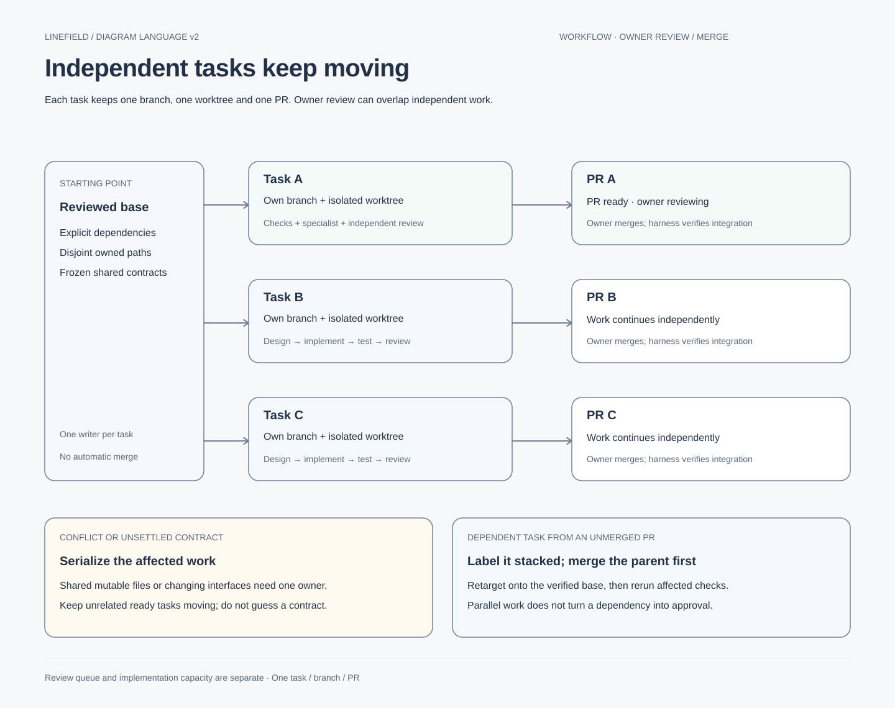

# Independent tasks and overlapping PR review

Adopted by decision239. One executable task still owns one branch and one PR. Owner review is
not a global development lock: other ready, independent tasks can proceed while a PR is open.

## Ready means independently reviewable

A leaf names its outcome, non-goals, approved scope, dependencies, frozen contract version, owned
paths, checks and integration order. Split by a coherent outcome, not by arbitrary file counts or
by separating implementation from its tests. A milestone remains a dependency map, not a giant PR.

Use three dependency labels:

- **Hard:** needs another task's merged, verified behavior or unresolved owner decision. Block
  dependent implementation; research against a proposal must say so.
- **Contract:** can proceed after the exact shared interface/fixture is frozen and authorized.
  One owner changes the contract; deviations pause affected consumers for coordination.
- **Independent:** does not need another task's unmerged changes, edits disjoint owned paths and
  can be tested/reverted on its declared base. It may proceed while that PR is in owner review.

Disjoint files alone are insufficient: shared runtime state, generated outputs, schema meaning,
package manifests and test fixtures can create semantic dependencies. Check those before Ready.
Default to two implementation writers and at most three subagents per harness session. Open PRs
need no active writer slot. Across chats, task records identify the sole writer/worktree and owned
paths; do not assume separate chats isolate a shared checkout. No new recurring scheduler is added.

## Branches and review

Independent leaves branch from the latest verified main and use separate worktrees. Never branch
from an unrelated pending PR just to obtain convenience changes. Review comments resume the same
task/branch/PR; freeze or hand off its writer before moving another chat onto it.

When shared infrastructure exists only in a pending PR, a dependent task may be prepared on an
explicitly **stacked** branch if its scope/contract is authorized. Its PR targets that parent branch,
identifies the parent PR/base SHA and cannot integrate first. After the parent merges, compare its
actual integrated content, retarget to main, reconcile conflicts and rerun affected checks. A stacked
PR is parallel preparation, not independent integration. Do not force-push shared branch history.

Only the owner merges. Every merge can invalidate another PR's integration evidence: refresh the
base and rerun checks affected by changed contracts, dependencies or conflicts. Do not import green
claims from another branch. Unchanged runtime inputs can reuse exact-hash evidence with that limit
stated; changed behavior needs fresh tests. Approval of one PR never approves all open branches.

## Minimal coordination

The [task board](../../tasks/README.md) lists readiness, dependencies, ownership and PR state.
Each task is the source for its detailed handoff. Keep common index/decision-log edits with the lead
or a small coordinated integration update; implementation leaves should not repeatedly edit global
handoff files. Generated outputs belong to their input owner and are regenerated, never hand-merged.
If two tasks discover shared ownership, serialize the contested slice or split a contract prerequisite.

At owner-review, release the writer and provide another **ready independent** task prompt immediately
if requested; no need to wait for the previous PR's merge. Label it as another task, not a completion
receipt. Only a merged-and-verified task receives a completion receipt. User notification of merge
triggers verification, not automatic assumptions about a squash/rebase SHA.

Current bootstrap exception: main contains the original foundation while PR #1 holds the delivered
prototype. DX-G02 is explicitly stacked on PR #1. The ready investigation leaves in the board use
that delivered baseline only after PR #1 integrates, or explicitly stack on it with the same rule.
