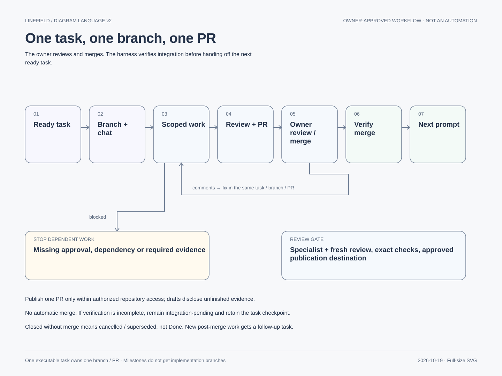
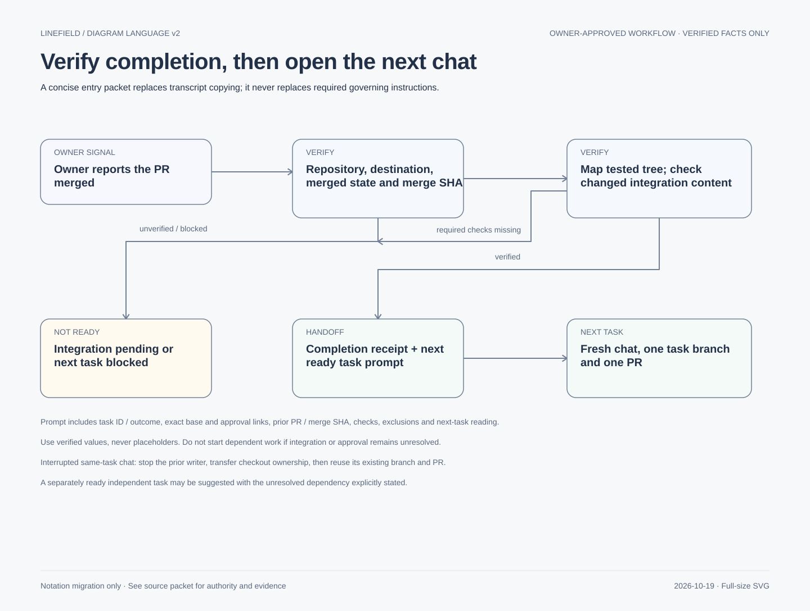

# Task → branch → PR → next chat

Adopted2026-10-19 by decision238. [Exact approved plan](task-pr-chat-plan.md) and
[approval record](../reviews/workflow-style-approval-2026-10-19.md) retain the full requirements.
This is the current visual entry point. Current bootstrap: [DX-G01](../../tasks/DX-G01.md).

Assign one ready executable task in a fresh chat. The harness checks authority/dependencies,
creates or reuses its branch, coordinates scoped design/implementation/tests and independent
review, and opens one PR in the approved repository. The owner reviews or requests changes;
fixes remain in the same branch/PR. The owner merges. Missing approvals or required evidence
block dependent work rather than silently expanding the task.

After the owner reports completion, verify the intended PR is merged and record its merge SHA.
Compare tested and integrated content, run affected checks when required, and confirm acceptance.
Only then provide a concise prompt for the next ready task in a fresh chat. If verification is
missing, keep integration pending. A replacement chat for an unfinished task reuses its branch
and PR only after the prior writer stops and ownership transfers.

Milestones such as S02/P05 contain multiple executable tasks; one child PR does not close the
whole milestone. Use [the task template](../../tasks/_template.md), [Git strategy](git-strategy.md)
and repository PR template. No automatic merge, release or scheduled review polling is enabled.
Diagrams explain the adopted process; they do not claim every proposed feature is authorized.
